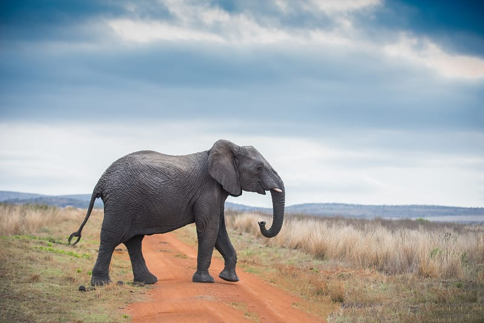

{"style": {"text": {"color": "#F4793B"}}}
**Focus:** The African elephant shows us how to be gentle.

{"style":{"image":{"aspectRatio":1.778}}}

- **What is the biggest and strongest land animal of all?** (The elephant!)

The African elephant is the biggest land animal in the world. They are also the strongest land animal and can carry up to seven tons of weight, which is the same as 130 grown-ups, or seven small cars!

Elephant tusks are actually super-long teeth. They use them to dig for water, peel bark off trees, and sometimes even to play with each other.

An elephant uses its trunk, like an extra hand, to grab and lift things. The trunk is also a nose, a straw for drinking water, a hose for spraying water, and a trumpet! Elephants also use their trunks to put mud on their bodies, which soothes their skin and protects them from the sun. Using their super-sniffer trunks, elephants can also smell water when it’s far away.

Elephants are huge—but they are also gentle giants. They love and protect each other. When elephants want to show love or comfort, they wrap their trunks around each other. Elephant aunties help moms take care of the babies. They babysit, play, and even help teach the little ones how to use their trunks.

When they go on the move as a big group, called a herd, they go in a parade! Everyone follows the leader, usually an older female elephant. Big families travel behind in a long line—great big elephants and little elephants, too.

Elephants have feelings. Sometimes they cry, especially when they lose someone they love—just as people do. They reach out and touch another elephant who is upset. If an elephant in their herd is sick or injured, the others will stay with them, help them stand, and even bring them food and water. When one elephant is injured or is carrying her baby calf, the whole herd of elephants will walk slower just so they can keep up.

What loving, gentle giants!

In our story today Moses had a kind heart. He stood up to bullies and tried to protect others. He also learned to follow God, just as the elephants follow their leader on parade.

**How can you be caring toward other people this week?**