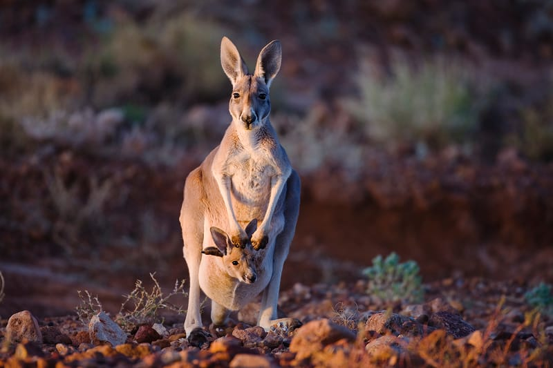

{"style": {"text": {"color": "#F4793B"}}}
**Focus:** A kangaroo’s pouch is a hiding place for joey kangaroos, just as God is a hiding place for us.

{"style":{"image":{"aspectRatio":1.778}}}

Ask the children to again share their favorite hiding places, or a share a few that they told you about before Sabbath School. Then invite them to listen carefully as you tell them about an animal who has a wonderful hiding place—wherever it goes.

**Do you know what a baby kangaroo is called?** (A baby kangaroo is called a joey.)

A mama kangaroo’s pouch is like a cozy pocket on her tummy that her baby can snuggle in and stay safe. When a joey is born, it is only the size of a jellybean. It cannot see or hear, and it has no fur, so it stays safe and warm inside its mama’s pouch for many months. There’s no fur inside the pouch, but baby joey stays much warmer against his mama’s soft skin. It’s the perfect place for kangaroos to grow. Inside the pouch God made the mama to be able to make special milk for the joey. This milk protects it from germs and sickness. As the joey gets bigger and bigger, the milk changes, so that the joey gets the best food.

As the joey gets bigger, it pokes its head out of the pouch as if saying, “Hi there!” but then jumps back in when it’s feeling shy, scared, or sleepy. The mama will then close the pouch up tight to keep it safe. Baby Joey can always be safe inside the little cozy pocket.

Mama kangaroos love to be close to their little joeys, and joey kangaroos always stay near their mamas so they can watch everything she does. They learn how to feed and clean themselves and how to watch out for danger.

For the joey kangaroos, their mama’s pouch is a hiding place in which they’re protected and cared for.

God loves to protect and care for us too. Our memory verse says, “You are my hiding place; You shall preserve me from trouble” (Psalm 32:7).

God loves us so much. He wants us to stay close to Him too!