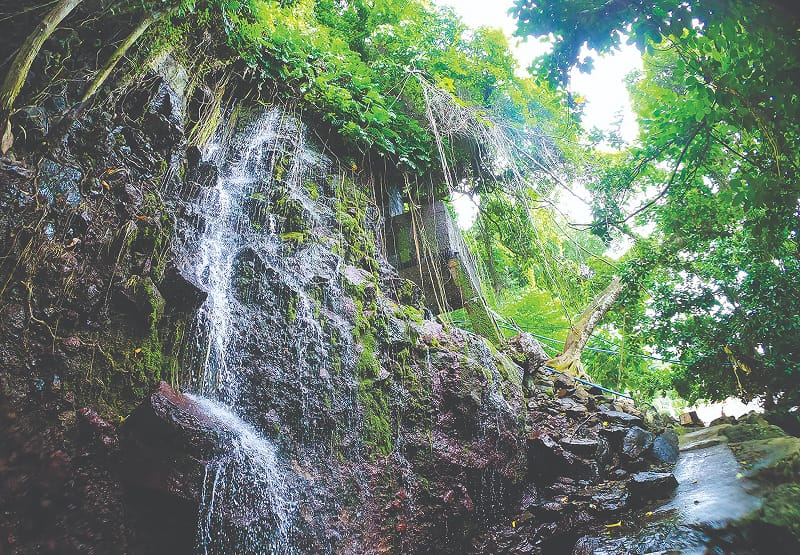

{"style": {"text": {"color": "#F4793B"}}}
**Focus:** God made waterfalls to make us happy and healthy.

{"style":{"image":{"aspectRatio":1.778}}}

- **Have you ever seen a waterfall in real life?**
- **What did you like most about it?**

A waterfall is like nature’s giant waterslide. Rivers tumble over the edge of a cliff—whoosh! Maybe you’ve heard the loud roar as the water crashes down, or felt the cool mist tickle your face, or smelled the fresh, clean air all around. A waterfall can be very big and powerful, or it can be small and trickle over rocks with little splashes. But all waterfalls are beautiful. Sometimes, when the sun shines just right, waterfalls can make sparkly rainbows in the mist.

Waterfalls are amazing! And guess what? They’re not just fun to look at—they’re good for you too!

When water falls through the air, it breaks into tiny drops. These little drops do something special. When we breathe them in, it’s like giving our body a mini power-up! They help us feel happy, healthy, and even help us sleep better. How special is that?

Water from waterfalls is some of the cleanest and yummiest water around. As the water flows over rocks, sand, and soil, it gets cleaned out—bye-bye, yucky bugs! What’s left is super-fresh water that’s safe to drink.

In fact, there’s a waterfall in the Philippines called **Tomalistis Falls** that has the sweetest-tasting water in the whole wide world! It’s even in the **_Guinness Book of World Records_**!

Do you think the water God gave to the Israelites in today’s story tasted even sweeter?

All the good things God gives us are like a waterfall. They just keep coming and coming into our lives. It would be special if our thanks back to God were like a waterfall too.

---

{"style": {"text": {"size": "sm"}}}
www.leytesamardailynews.com/tomalistis-falls-the-sweetest-water-in-the-world