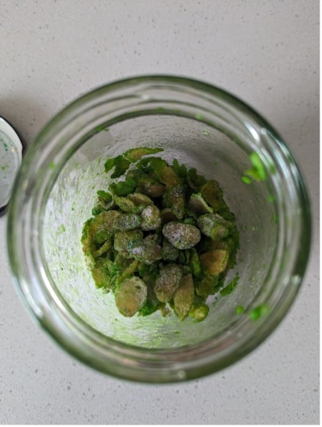
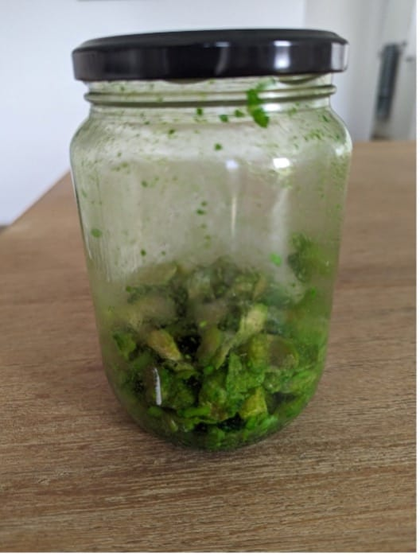

{"style": {"text": {"color": "#F4793B"}}}
**Big Idea:** God’s way is best. He provides for all of my needs.

As you prepare to share this story, please read the student guide for the full, detailed narrative. Include additional props as needed, depending on what you have available. To maximize engagement, avoid reading the story to the children. See the storytelling suggestions at the front of this publication.

```=Storytelling Suggestions

- Show the ^[►]({"style": {"text": {"color":"#d34d5e"}}}) pictures from the student guide as you tell the story (**^[week 7 Program PowerPoint]({"style": {"text": {"color": "#58B0E3"}}})**).
- Suggested props: make some **“birds” from things that are plentiful in your location**: seedpods, pinecones, craft balls or balloons, or scrunched-up scrap paper. Lay a **large cloth** on the ground and sprinkle with **crackers or wafers or cereal as “manna.”** Collect in a **bowl**.
- Prepare fake moldy manna prior to the lesson (add two drops of **green food coloring** and one teaspoon of **vinegar** to a **jar of “manna”** and shake).





- Use peg people (Moses, families) or a felt set if desired.
- Use expressive tones and actions to engage the children’s interest.

```

**Pray:** Before you begin, pray. Ask God to help everyone understand today’s Bible story. By doing this, you will model how important it is to pray to invite God to teach us from His living Word before we read the Bible.

{"style": {"text": {"color": "#649b7c", "size": "lg"}}}
**TELL THE STORY: QUICK CUES**

- The people grumbled and complained. They stomped their feet. They were hungry!
- They had forgotten God’s care. But God would still provide for them. He promised bread from heaven.
- The people awoke to manna all over the camp. Mmm, yum! It tasted like wafers with honey ^[(crackers/wafers)]({"style": {"text": {"color":"#d34d5e"}}}).
- They quickly collected it ^[(bowl)]({"style": {"text": {"color":"#d34d5e"}}}). God said to collect only enough for that day—to trust Him to provide again tomorrow and the next day after that.
- Some people didn’t listen and took extra manna for the next day. In the morning their extra manna was rotting! ^[(Jar of green manna.)]({"style": {"text": {"color":"#d34d5e"}}})
- On Friday they were told to collect extra for Sabbath—and it didn’t rot. ^[(Collect more with bowl.)]({"style": {"text": {"color":"#d34d5e"}}}) There was no manna on Sabbath—it was the day of rest.
- After a while some troublemakers wanted other food—meat. They complained and cried.
- God sent quail on a big wind—but there would be a consequence. ^[(Helpers to throw “birds” on scene.)]({"style": {"text": {"color":"#d34d5e"}}})
- The people greedily collected quail all day and night. Then they ate it and were sick. Some people died.
- If only they had trusted God to give them what they needed.

{"style": {"text": {"color": "#649b7c", "size": "lg"}}}
**TELL THE STORY**

^[►]({"style": {"text": {"color":"#d34d5e"}}}) The grumbling started in their minds, but then the people started to say their thoughts aloud. Little girls and boys whined. Mothers and fathers complained. Soon all the Israelites grumbled to Moses and Aaron. They were hungry!

They were so hungry that they even started to wish they’d never left Egypt. They’d forgotten how badly they’d been treated as slaves. They’d also forgotten all of God’s miracles and care for them.

But God would still provide for them. He knew they were hungry, and He loved them. He said, “I will rain bread from heaven for you” (Exodus 16:4).

^[►]({"style": {"text": {"color":"#d34d5e"}}}) As the sun rose the next morning, the Israelites jumped out of bed with excitement. Quickly they peeked outside their tents. Lying on the ground all around their camp were small, round white flakes. ^[(Show the cloth covered with “manna.”)]({"style": {"text": {"color":"#d34d5e"}}})

The people called it “manna.” They rushed out with their bowls to collect it. Mmm, yum! God’s miracle manna bread “tasted like wafers made with honey” (Exodus 16:31, ICB).

^[►]({"style": {"text": {"color":"#d34d5e"}}}) Mmm, yum! They put some more in their bowl ^[(bowl)]({"style": {"text": {"color":"#d34d5e"}}}). God told them to collect only what they needed for the day. He promised to send new, fresh manna every morning.

But some people didn’t listen. They didn’t trust God to be their provider. After they’d eaten their sweet, yummy bread, they kept a little extra and stored it away for tomorrow.

When they woke up the next day, their tent was filled with a terrible, horrible stink. Their manna was rotting and filled with wriggling worms. ^[(Show the rotten manna.)]({"style": {"text": {"color":"#d34d5e"}}}) Yuck! They should have trusted and listened to God.

^[►]({"style": {"text": {"color":"#d34d5e"}}}) Every morning the ground around the camp was covered in manna. How amazing! Then, on Friday morning the people woke up to collect their manna as usual. But this time they took an extra-big bowl with them ^[(bowl)]({"style": {"text": {"color":"#d34d5e"}}}). God had told them that there would be no manna the next day, on Sabbath. God wanted to teach them that the Sabbath was a day to rest from their work, to spend time together and with God. So they needed to collect extra on Friday—and it wouldn’t go bad on Sabbath.

^[►]({"style": {"text": {"color":"#d34d5e"}}}) God provided food, water, and Sabbath rest. What a good God! But after a while some troublemakers wanted different food. “We want meat!” they said.

God was disappointed that the people didn’t trust Him. He gave them the meat they wanted, but there would be a consequence for their selfishness.

^[►]({"style": {"text": {"color":"#d34d5e"}}}) Whoosh! The wind blew strongly through the sandy desert. The sky filled with flapping birds, carried into camp by the wind. ^[(Have adult helpers lay out the “birds.”)]({"style": {"text": {"color":"#d34d5e"}}}) These little birds were called quail. Thousands and thousands of quail flew straight into the Israelites’ camp. The quail were everywhere!

The Israelites raced around excitedly. They filled their baskets, their bags, and their tents with birds. But they didn’t stop—not even to sleep. They wanted more, and more, and more!

As they began greedily gobbling up the food, they became very sick. Some people even died.

If only the Israelites had trusted God. They could have been happy with the healthy manna God had already provided for them.