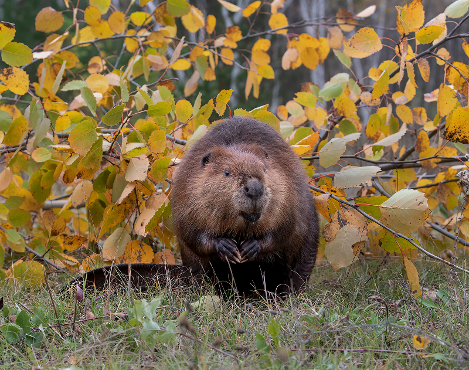

{"style": {"text": {"color": "#F4793B"}}}
**Focus:** We can help our families, just like beavers.

{"style":{"image":{"aspectRatio":1.778}}}

Have you ever heard someone say “Busy as a beaver” or “Eager beaver”? That’s because beavers are really hard workers! Beavers work hard to build awesome homes in the water. Their cozy home is called a lodge. It is made of sticks and mud on the edge of the water. Inside, there are little rooms, kind of like a treehouse with bedrooms! They work together as a family to float logs down rivers and stack them up to make dams. These dams slow the water down and make a nice, calm pond where their lodge can stay safe and dry.

Beaver families are close. The beaver family has a mom, a dad, baby beavers (called kits), and even older brothers and sisters who are still living at home. The older beavers help take care of the little ones by feeding them, grooming them, and protecting them. How special! They love living together in their lodge.

Have you seen their flat, paddle-shaped tails? Beavers use their tails like rudders to swim really well. If there’s danger nearby—such as a wolf or a bear—the beaver gives a big SLAP! on the water with its tail to say, “Watch out!” That tells the family to dive under the water or hide inside the lodge. What a great splashy alarm system God has given them.

Beavers don’t just help their own families—they help lots of other animals too. Their dams create homes for birds, frogs, fish, and even insects. The ponds they make give animals fresh water to drink, and they even help keep the water clean for people.

Beavers may be small, but they make a big difference in the world just by working together as a family and caring for others—just as you can!

---

https://home.nps.gov/gaar/learn/nature/beaver.htm