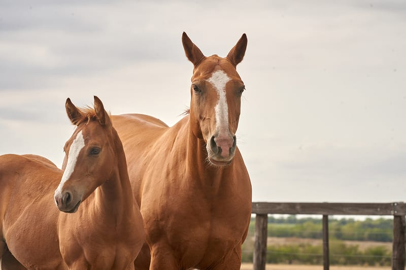

{"style": {"text": {"color": "#F4793B"}}}
**Focus:** We can show love and respect for others, just as horses do.

{"style":{"image":{"aspectRatio":1.778}}}

Hold up **Nature Card 62: Horses**

- **Have you ever wished you could have a horse as a pet?**

Horses are strong, beautiful animals that have helped people for a very long time. People ride them for fun, to do jobs, or to travel long distances. Horses were used to pull carts, farming plows, or racing buggies. Horses can be used in sports or they can be loved as special animal friends.

But how do people get horses to listen and help? Well, first they have to be kind and caring. Horses need food, brushing, hugs, and time with their humans. When a horse knows you care about them, they learn to trust you—and then they’re happy to help you!

Horses are very smart. They can remember people and even tell if someone is feeling happy, sad, scared, or angry. Just being around a horse can help you feel calmer inside. That’s why horses sometimes help people who are sick or feeling down—just by being gentle and friendly.

Horses also love to make friends. They make friends with other horses, animals, and people too. And guess what? They have their own way of talking!

- If a horse snorts, it means they feel happy or relaxed.
- If their ears are back, they might be curious, scared or upset.
- If they nuzzle your arm with their nose, they’re saying, “I love you!”

Horses show love and respect in all kinds of ways—and they remind us that we can show love and respect to others too! It’s so good that we can pass love along to someone else too.

---

https://www.petmd.com/horse/do-horses-show-affection.