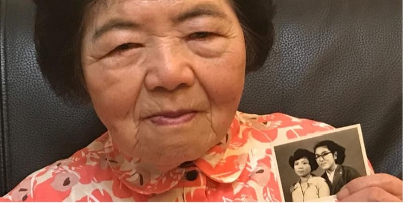

{"style": {"text": {"color": "#F4793B"}}}
**Focus:** We worship the one true God.

**Location:** Invite a child to help you find **Taiwan** on your **globe** or **world map**.

{"style":{"image":{"aspectRatio":1.778}}}

Zhui Wen-Zhi (“Zhway Wen-Jee”) grew up in a poor farming family. For as long as she could remember, they would often bow down to worship an idol made of wood.

When Wen-Zhi grew up, she moved to the city for work. One night she went to some meetings run by the Seventh-day Adventist church. It was the first time she had ever heard about Jesus. She began going to church every Sabbath. Soon she became best friends with another young woman, and together they studied the Bible.

One day Wen-Zhi was reading Isaiah 44. “There is no other God. . . . But the man makes a statue from the wood. . . . He calls it his god. He bows down to it and worships it” (Isaiah 44:8-17, ICB). Wen-Zhi thought about her family’s idol and decided to find out if it really was just a block of wood. She visited the shop where idols were made, and saw that it was true: idols were simply made of wood by a man.

From that point on, Wen-Zhi chose to worship only Jesus.

Wen-Zhi told her husband that she was going to be a Christian. He told her he didn’t mind, but one Sabbath he became angry when she refused to help him work on the house. From then on, Wen-Zhi’s husband treated her badly because of her faith.

Wen-Zhi decided to get baptized. But she was afraid to tell her husband. What would he say? Wen-Zhi prayed for God’s help.

The night before the baptism Wen-Zhi told her husband that she wanted to be baptized the next day. To her surprise, her husband said, “OK.”

Wen-Zhi’s prayer was answered. Forty years later another prayer was answered when her husband finally chose to be baptized too.

Wen-Zhi is now 87 years old. “God always answers prayer,” she says. “He is not a block of wood. There is no other God.”

---

{"style": {"text": {"size": "sm"}}}
This story is adapted from “No Block of Wood” by Andrew McChesney, _Children’s Mission_, copyright © 2018 General Conference of Seventh-day Adventists®. Used and adapted by permission.