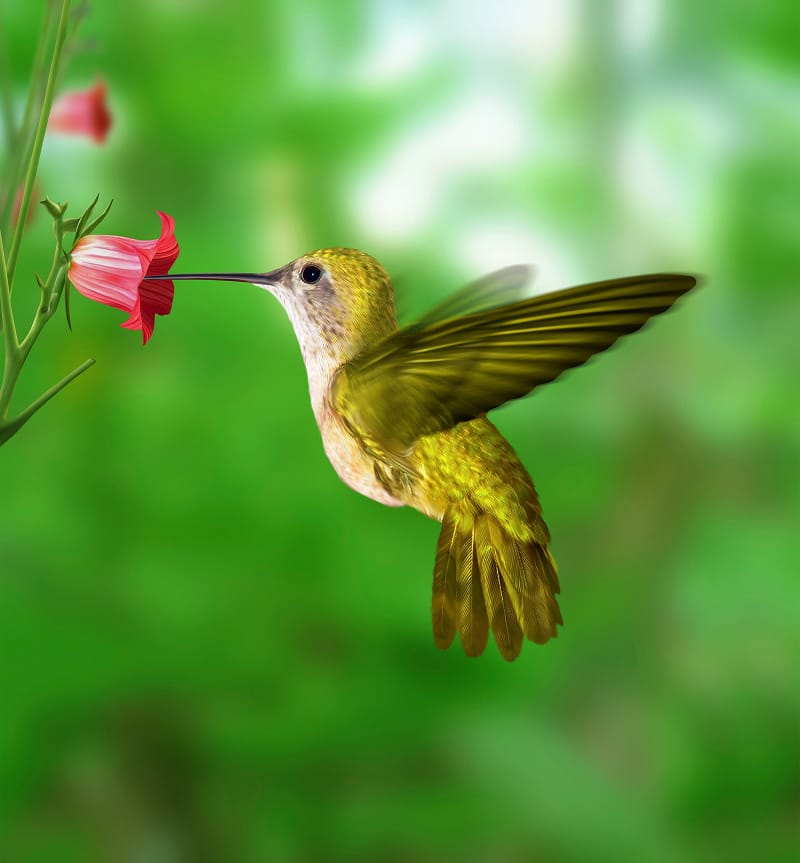

{"style": {"text": {"color": "#F4793B"}}}
**Focus:** The hummingbird makes a tiny, special home with love and care. God wants His home to be with us!

{"style":{"image":{"aspectRatio":1.778}}}

Hummingbirds are some of the smallest birds in the world, but they are amazing builders! A mother hummingbird makes a nest so tiny it can be as small as a walnut shell. She uses her beak like tiny fingers, carefully picking up soft plant fluff, bits of moss, and even spider silk. She doesn’t use glue or string—she uses what God gives her in nature. The spider silk works like stretchy thread, holding everything together. Piece by piece, she presses and pats and shapes her nest into a soft little cup.

The hummingbird doesn’t build just anywhere. She chooses just the right branch, often on a thin, bouncy twig that’s hard for bigger animals to reach. Then she decorates the outside with bits of moss and lichen so it blends in and hides. Her nest is like a tiny hidden treasure, hard to see, but full of love. Because she uses stretchy spider silk, the nest can grow as her babies grow. What starts as a tiny cradle slowly stretches to hold two growing chicks.

Building this nest takes time and care. The mother hummingbird works patiently, going back and forth again and again to gather just the right pieces. In the end, her nest becomes a safe, cozy place where her eggs can rest and where her babies can be fed and loved. It may be small, but it is made with great love, gentleness, and wisdom.

God made many animals who build special homes, and the hummingbird is one of His sweetest examples. Just like

the hummingbird carefully builds a safe, loving nest for her babies, God wants to make His home with you. He wants

to be very close to you—in your heart—shaping it gently, piece by piece, into a special place where His love can live and grow.