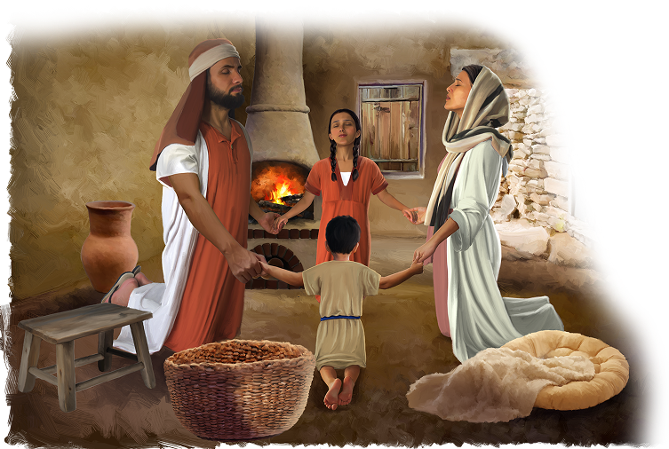

{"style":{"block":{"padding":{"start":"none","end":"none"},"rounded":false},"wrapper":{"padding":{"start":"none","end":"none"}},"image":{"aspectRatio":1.778}}}

{"style": {"text": {"typeface": "DKWhaleSong-Regular", "color": "#00929C", "size": "xl"}}}
**Big Idea:**\
God’s way is best. He has great plans for my life.

**^[Memory Verse]({"style": {"text": {"typeface": "DKWhaleSong-Regular", "size": "lg"}}})**\
_^[“For I know the thoughts I think toward you, says the Lord, thoughts of peace and not of evil, to give you a future and a hope”]({"style": {"text": {"color": "#00929C"}}})_ (Jeremiah 29:11).

**Word of the Week**\
_^[“Protect”]({"style": {"text": {"color": "#00929C"}}})_ - To protect is to keep something or someone safe. A parent or caring adult might hold your hand when you cross the road, so they can protect you from traffic. God protects His children too. He wants to save us and keep us from danger.

**This week’s lesson**\
is based on Exodus 1; 2:1-10; _Patriarchs and Prophets_, pp. 241-246.

{"style":{"block":{"padding":{"start":"none","end":"none"},"rounded":false},"wrapper":{"padding":{"start":"none","end":"none"}},"image":{"aspectRatio":1.778}}}

{"style": {"text": {"typeface": "DKWhaleSong-Regular", "color": "#A0BA3B", "size": "xl"}}}
In Egypt

Pharaoh’s fancy palace stood tall and proud. Strong stone temples were spread across the land. The fields in Egypt were full of food and strong and healthy animals.

God’s people, the children of Israel, were safe and happy here. When Joseph was in charge, they had moved to a part of Egypt called Goshen. Now, after many years, they were still living there. The kind pharaoh treated them well. Over time, something happened to them. What was it? **Read Exodus 1:7.**

The Israelites filled the land like busy ants! But although the Israelites lived _in_ Egypt, they didn’t live like the Egyptians. They didn’t build their own fancy palaces or strong stone temples to idols. They didn’t dress and act like the Egyptians or bow down to their gods. Instead, they worshipped the one true God and followed His ways.

Have you ever noticed what shape water becomes when it’s poured into a cup? You’ll see that whatever shape your cup is—short, tall, wide, or skinny—the water will fill it and become that shape.

The Israelites had been placed inside Egypt. They could have been like water in a cup and changed to become like the Egyptians around them. But the Israelites knew they were God’s own special people (1 Peter 2:9). They stayed “God-shaped” even though they were surrounded by Egyptians who worshipped idols.

God can help you to stay God-shaped too!

^[I Wonder]({"style": {"text": {"typeface": "DKWhaleSong-Regular", "color": "#C393C2", "size": "lg"}}})

- How do you think the Egyptians and Israelites were different? (For example: clothing, homes, food, worship.)

^[Prayer Idea]({"style": {"text": {"typeface": "DKWhaleSong-Regular", "color": "#C393C2", "size": "lg"}}})\
Ask God to help you stay God-shaped no matter where you are.

{"style": {"block": {"backgroundColor": "#EFE8D8", "padding": {"top": "sm", "start": "base", "end":"sm", "bottom": "sm"}}}}
^[Parent Faith Talk]({"style": {"text": {"typeface": "DKWhaleSong-Regular", "color": "#00929C", "size": "lg"}}})\
Share a time you stayed God-shaped even when everyone around you was doing something different.