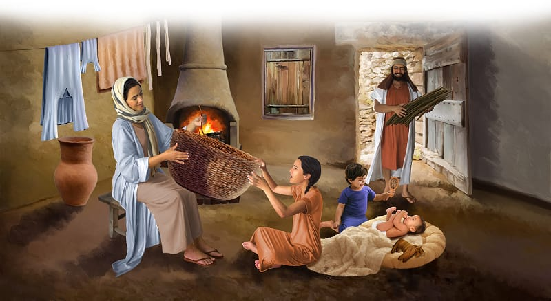

{"style":{"block":{"padding":{"start":"none","end":"none"},"rounded":false},"wrapper":{"padding":{"start":"none","end":"none"}},"image":{"aspectRatio":1.778}}}


Father Amram and Mother Jochebed lived in a simple home in Goshen. They loved God with all of their hearts. They had three beautiful children: big sister Miriam, little brother Aaron, and a brand-new cuddly baby boy.

Amram and Jochebed loved God with all of their hearts—and they taught their children to love Him too. When Amram and Jochebed heard the evil pharaoh’s command to throw the baby boys in the river, they knew there was no way they would ever let that happen to their little baby! They trusted God, and “they were not afraid” (Hebrews 11:23, ICB). They decided to hide their precious little baby in their home.

Imagine hiding a baby! Babies don’t lie still and quiet all day. They cry, giggle, gurgle, chatter, and . . . scream! How long did Jochebed hide her baby boy? **Read Exodus 2:2.**

It became harder and harder to keep her baby hidden. He was probably getting too big and too loud! What should they do?

Then one day God gave Mother Jochebed a great idea. She collected some long river reeds and began weaving them together to make a basket. She smeared it with sticky tar (like a thick glue), so water couldn’t leak inside. It would be a basket boat!

Gently Jochebed placed her baby boy inside. With Miriam by her side, she carried her secret basket boat to the river. Then she hid the little boat near the water’s edge among the tall grass.

No one knew the family’s secret plan to protect and save their little baby, but God did. Our caring God watched very closely. God had a plan for this baby, and He has a loving plan for you too.

^[I Wonder]({"style": {"text": {"typeface": "DKWhaleSong-Regular", "color": "#21A0A9", "size": "lg"}}})

- Do you think the baby boy liked it inside the basket? Why?
- What might happen next?

^[Prayer Idea]({"style": {"text": {"typeface": "DKWhaleSong-Regular", "color": "#21A0A9", "size": "lg"}}})\
Thank Jesus that He has great plans for your life and that He watches over you in all you do.

^[Do]({"style": {"text": {"typeface": "DKWhaleSong-Regular", "color": "#21A0A9", "size": "lg"}}})\
Play a game of hide-and-seek. Remember that Jesus knows where you are all the time.

```=Memory Verse

“For I know the thoughts I think toward you, says the Lord, thoughts of peace and not of evil, to give you a future and a hope” (Jeremiah 29:11).

```