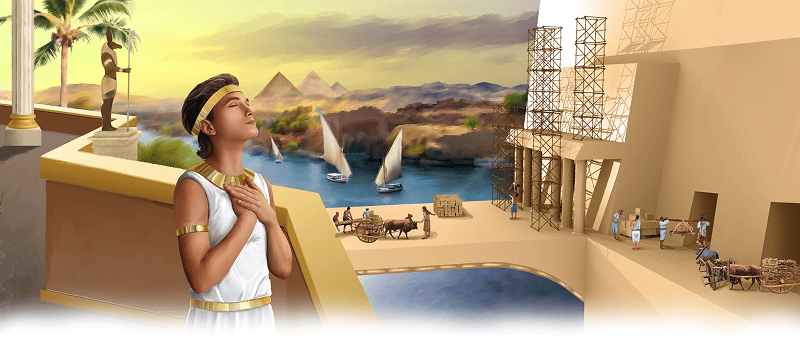

{"style":{"block":{"padding":{"start":"none","end":"none"},"rounded":false},"wrapper":{"padding":{"start":"none","end":"none"}},"image":{"aspectRatio":1.778}}}


Father Amram, Mother Jochebed, sister Miriam, and brother Aaron were so happy to have their baby safely back at home. They didn’t have to hide him anymore!

Little Moses grew up in a home where his family loved him and they loved God. Every day his family taught him about our loving God, who had protected him in the basket boat and sent the princess to save him.

When Moses was about 12 years old, he left his little Hebrew house and moved into the royal palace. The princess adopted Moses and “brought him up as her own son” (Acts 7:21). The slave’s son was turned into a prince!

Many important people in the palace made plans for this boy—plans for him to be rich, smart, and powerful, and they wanted him to worship their idols. Moses would need to remember to trust God. What does the Bible tell us God has planned for us? **Read Jeremiah 29:11.**

God had the best plans for Moses. He planned to use Prince Moses one day to free the Israelite slaves from Egypt. How exciting!

^[I Wonder]({"style": {"text": {"typeface": "DKWhaleSong-Regular", "color": "#21A0A9", "size": "lg"}}})

- What do you think the Israelite slaves thought of Prince Moses?

^[Prayer Idea]({"style": {"text": {"typeface": "DKWhaleSong-Regular", "color": "#21A0A9", "size": "lg"}}})\
Thank Jesus for the big plans He has for your life.

^[Do]({"style": {"text": {"typeface": "DKWhaleSong-Regular", "color": "#21A0A9", "size": "lg"}}})\
Play a game of “Opposites” based on Moses’ life. What are the opposites of these words? poor; child; slave; idol worshipper; weak. Can you think of any other opposites to match?

```=Memory Verse

“For I know the thoughts I think toward you, says the Lord, thoughts of peace and not of evil, to give you a future and a hope” (Jeremiah 29:11).

```

{"style": {"block": {"backgroundColor": "#B4B5B4", "padding": {"top": "sm", "start": "base", "end":"sm", "bottom": "sm"}}, "text": {"color": "#FFFFFF"}}}
^[Friday Night Family Activity]({"style": {"text": {"typeface": "DKWhaleSong-Regular", "size": "lg"}}})\
Print the True Treasure Map from the Alive in Jesus website, or draw your own with 13 large squares from start to finish (one for each lesson this quarter). In the first space, draw or glue something from this week’s story that reminds you that God’s way is best. Write or read this week’s memory verse at the top of the map.\
\
^[For You, Parents]({"style": {"text": {"typeface": "DKWhaleSong-Regular", "size": "lg"}}})\
“To a very great extent the mother holds in her own hands the destiny of her children. . . . The impressions now made upon their developing minds will remain with them all through life” (Ellen G. White, _Patriarchs and Prophets_, p. 244).