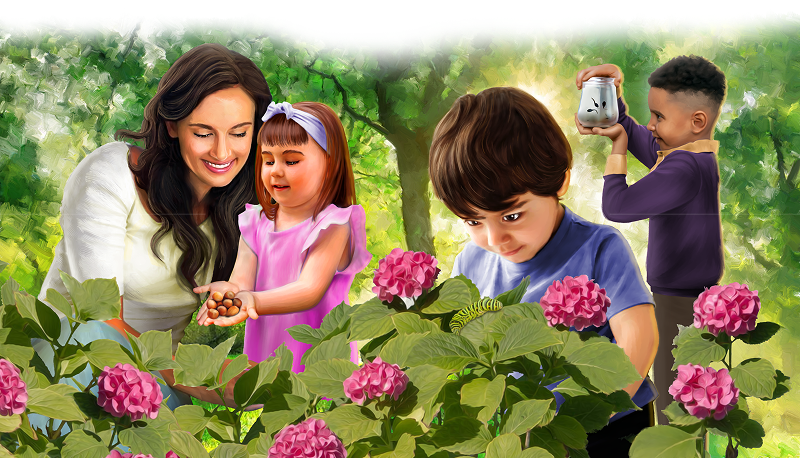

{"style":{"block":{"padding":{"start":"none","end":"none"},"rounded":false},"wrapper":{"padding":{"start":"none","end":"none"}},"image":{"aspectRatio":1.778}}}

_(Before beginning, find a picture of your child that was taken a year ago.)_

You are constantly changing. How are you different from when this photo was taken? (Discuss together.)

You have become taller, stronger, and faster. Did you know that you have learned at least 2,000 new words you didn’t know a year ago? Well done!

What other things have you learned to do? Read or count? Draw or write? Kick a ball or balance on one foot?

God has plans to make you into something wonderful. He wants good to come from your life, even when some days seem hard or sad. He says in Jeremiah 29:11: “For I know the thoughts I think toward you, says the Lord, thoughts of peace and not of evil, to give you a future and a hope.”

**^[Activity]({"style": {"text": {"typeface": "DKWhaleSong-Regular", "size": "lg", "color": "#CF4D73"}}})**

**Go for a walk in nature with a basket. Collect items that change over time.**

Your life is just like these things. God plans to turn your life and future into something amazing. He wants to do great things with your life today and always. Your future is as big and important as the life of Prince Moses.

{"style": {"block": {"backgroundColor": "#C17EB6", "padding": {"top": "sm", "start": "base", "end":"sm", "bottom": "sm"}}, "text": {"color": "#FFFFFF"}}}
**^[Challenge]({"style": {"text": {"typeface": "DKWhaleSong-Regular", "size": "lg"}}})**\
Look at the things the children are looking at in the illustration above. What will each of these things turn into with time?