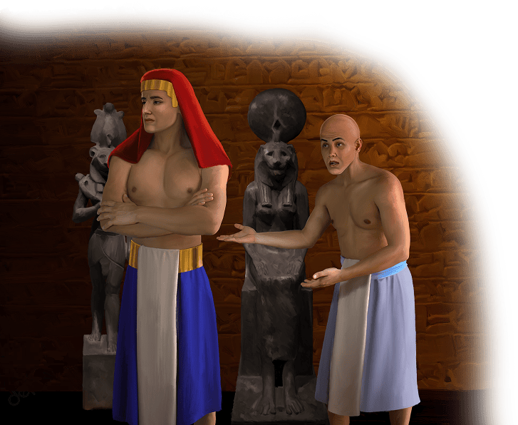

{"style":{"block":{"padding":{"start":"none","end":"none"},"rounded":false},"wrapper":{"padding":{"start":"none","end":"none"}},"image":{"aspectRatio":1.778}}}

{"style": {"text": {"typeface": "DKWhaleSong-Regular", "color": "#00929C", "size": "xl"}}}
**Big Idea:**\
God’s way is best. I can follow Him.

**^[Memory Verse]({"style": {"text": {"typeface": "DKWhaleSong-Regular", "size": "lg"}}})**\
_^[“Create in me a clean heart, O God, and renew a steadfast spirit within me”]({"style": {"text": {"color": "#00929C"}}})_ (Psalm 51:10).

**Word of the Week**\
_^[“Change”]({"style": {"text": {"color": "#00929C"}}})_ - Change means to make something different. You can change clothes, and put on different clothes. Or you might make a different choice to play outside instead of inside—you could change your mind. Caterpillars change into butterflies; tadpoles change into frogs. God can change us so we are loving, faithful Christians.

**This week’s lesson**\
is based on Exodus 2:11-23; 3; 4:1-17; _Patriarchs and Prophets_, pp. 246-256.

{"style":{"block":{"padding":{"start":"none","end":"none"},"rounded":false},"wrapper":{"padding":{"start":"none","end":"none"}},"image":{"aspectRatio":1.778}}}

{"style": {"text": {"typeface": "DKWhaleSong-Regular", "color": "#ACC354", "size": "xl"}}}
Lessons and Learning

Moses now lived in the magnificent king’s palace, and the Egyptian princess was his new mother. That meant that Pharaoh had become his grandfather! The very man who wanted to throw him into the river as a baby now called him family. Isn’t it amazing what God can do?

Prince Moses was taught by the best teachers in the land. What did the Egyptians teach him? **Read Acts 7:22.**

Even though Moses learned how to be an Egyptian prince, he never forgot the things Mother Jochebed had taught him when he was little. He knew God loved him and had protected and saved him.

In our memory verse (Psalm 51:10) King David asks God to give him a steadfast spirit. This means to be strong; to stick up for what we know is true and right. God gave Moses a strong spirit so that he would worship God and not idols. God can help us to be strong like this too.

Pharaoh had many palaces and lots of gold. But Moses knew that God, the King of the universe, was greater! He would rather follow God than have all “the treasures in Egypt” (Hebrews 11:26). No Egyptian palace could ever be as wonderful as his future home in heaven with God!

^[I Wonder]({"style": {"text": {"typeface": "DKWhaleSong-Regular", "color": "#C393C2", "size": "lg"}}})

- What are you learning about this week? What is something new you’d like to learn?

^[Prayer Idea]({"style": {"text": {"typeface": "DKWhaleSong-Regular", "color": "#C393C2", "size": "lg"}}})\
Ask God to help you live like the prince/princess He has made you to be.

^[Do]({"style": {"text": {"typeface": "DKWhaleSong-Regular", "color": "#C393C2", "size": "lg"}}})\
Make and decorate a crown using whatever materials you find at home.