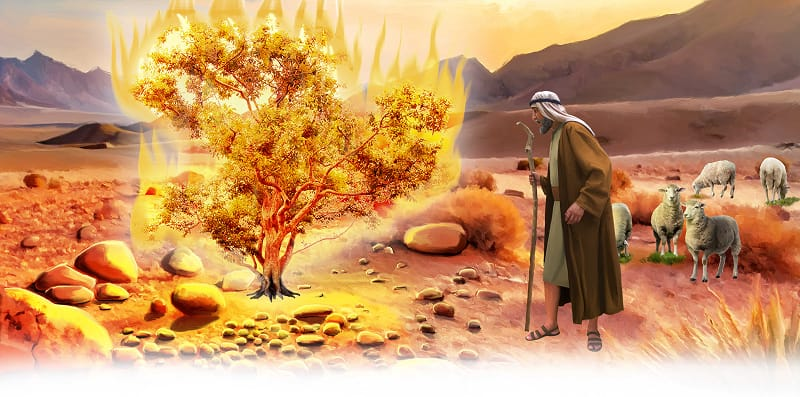

{"style":{"block":{"padding":{"start":"none","end":"none"},"rounded":false},"wrapper":{"padding":{"start":"none","end":"none"}},"image":{"aspectRatio":1.778}}}


No longer was Moses a prince with a shiny crown. Instead, he lived a quiet life as a shepherd, looking after his sheep. Just as his woolly lambs learned to follow his voice, Moses learned to follow God. He could see God’s love and power in the beautiful sunsets, rolling hills, tall mountains, fluffy sheep, and his happy family. It changed him.

**What does Numbers 12:3 say about Moses?**

One day humble Moses was walking slowly through the desert with his clip-clopping sheep following behind him. Suddenly he noticed something very strange. There, on the side of a mountain, he could see a bush covered with bright flickering flames. The bush was covered in fire, but it wasn’t burning up!

_How can a bush continue burning without burning up?_ he thought to himself. His curiosity grew as he stepped closer and closer.

All of a sudden a voice called out from the bush: “Moses, Moses!”

A talking bush?

“Here I am,” answered Moses, trembling.

“Take off your sandals. You are standing on holy ground. . . . I am the God of Abraham, the God of Isaac and the God of Jacob” (Exodus 3:5, 6, ICB).

Humbly Moses covered his face. He realized the God who had made the beautiful sunsets, rolling hills, tall mountains, fluffy sheep, and all people was speaking out loud to him!
God wants to speak to you through His words in the Bible too. The Bible tells us that Jesus said, “My sheep hear My voice, and I know them, and they follow Me” (John 10:27).

^[I Wonder]({"style": {"text": {"typeface": "DKWhaleSong-Regular", "color": "#7994CC", "size": "lg"}}})

- Can you think of different ways that God can “talk” to you?

^[Prayer Idea]({"style": {"text": {"typeface": "DKWhaleSong-Regular", "color": "#7994CC", "size": "lg"}}})\
Ask Jesus to help you listen to His words and follow Him.

^[Do]({"style": {"text": {"typeface": "DKWhaleSong-Regular", "color": "#7994CC", "size": "lg"}}})\
Go for a walk outside, or look at beautiful pictures of nature, and thank Jesus for showing you His love and power.

^[Mission Challenge]({"style": {"text": {"typeface": "DKWhaleSong-Regular", "color": "#7994CC", "size": "lg"}}})\
Use your craft from Sabbath School to share Moses’ story with someone in your family—perhaps a brother, sister, or cousin.

```=Memory Verse

“Create in me a clean heart, O God, and renew a steadfast spirit within me” (Psalm 51:10).

```