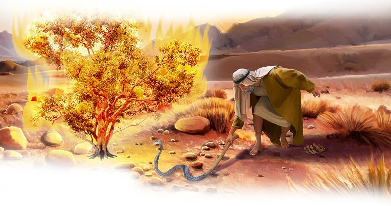

{"style":{"block":{"padding":{"start":"none","end":"none"},"rounded":false},"wrapper":{"padding":{"start":"none","end":"none"}},"image":{"aspectRatio":1.778}}}


As Moses listened to God speak through the burning bush, he asked God a question. “What if the people of Israel do not believe me or listen to me? What if they say, ‘The Lord did not appear to you’?” (Exodus 4:1, ICB).

God saw Moses’ walking stick and said, “Throw it on the ground” (Exodus 4:3, ICB). So Moses obeyed and threw it on the ground. Instantly the stick became a wriggling, squirming snake. Eek! Moses jumped out of the way in surprise.

Then God told him to grab the snake by the tail, and it became a stick again. How amazing! A stick, to a snake, to a stick again. God said, “When this happens, the Israelites will believe” (Exodus 4:5, ICB).

God gave Moses another two miracles to show the Egyptians. What were they? **Read Exodus 4:6-9.**

Moses was still nervous about this big job, so God encouraged him again. He promised to send Aaron, Moses’ big brother, to be his helper. “You will tell him what God says. And he will speak for you,” God explained (Exodus 4:16, ICB).

Moses didn’t need to worry, God was going to make this happen! God could change a stick . . . a person’s skin . . . and water! But better still, God could change Moses’ heart.

He wants to change our hearts too, so we can be strong, and follow Him. “Create in me a clean heart, O God, and renew a steadfast spirit within me” (Psalm 51:10).

^[I Wonder]({"style": {"text": {"typeface": "DKWhaleSong-Regular", "color": "#21A0A9", "size": "lg"}}})

- Why was Moses so nervous about doing this job for God?

^[Prayer Idea]({"style": {"text": {"typeface": "DKWhaleSong-Regular", "color": "#21A0A9", "size": "lg"}}})\
Thank God for His power to change us.

^[Do]({"style": {"text": {"typeface": "DKWhaleSong-Regular", "color": "#21A0A9", "size": "lg"}}})\
Act out God’s miracle of the stick transforming into a snake.

```=Memory Verse

“Create in me a clean heart, O God, and renew a steadfast spirit within me” (Psalm 51:10).

```

{"style": {"block": {"backgroundColor": "#B4B5B4", "padding": {"top": "sm", "start": "base", "end":"sm", "bottom": "sm"}}, "text": {"color": "#FFFFFF"}}}
^[Friday Night Family Activity]({"style": {"text": {"typeface": "DKWhaleSong-Regular", "size": "lg"}}})\
On the second blank space of the True Treasure Map, draw or glue something from this week’s story that reminds you that God’s way is best. Review the previous week.\
\
^[For You, Parents]({"style": {"text": {"typeface": "DKWhaleSong-Regular", "size": "lg"}}})\
“Never be afraid to trust an unknown future to a known God” (Corrie Ten Boom).