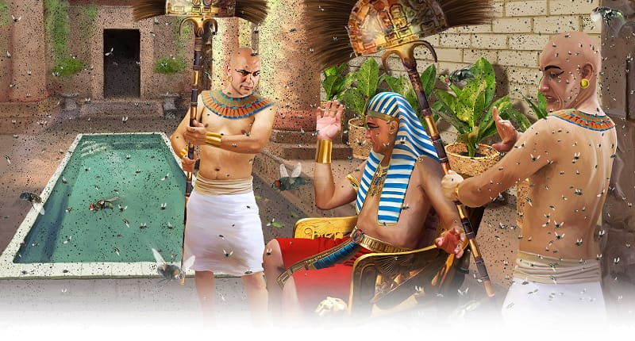

{"style":{"block":{"padding":{"start":"none","end":"none"},"rounded":false},"wrapper":{"padding":{"start":"none","end":"none"}},"image":{"aspectRatio":1.778}}}


Aaron stretched out his staff again and hit the dusty ground with a thud. All throughout Egypt the dust turned into little insects called lice (Exodus 8:16). These tiny biting insects crawled all over the people’s skin and all through their hair. The people itched and scratched, and scratched some more.

“The magicians told the king that the power of God had done this. But the king was stubborn and refused to listen to them” (Exodus 8:19, ICB).

So God sent Pharaoh another warning. What was it? **Read Exodus 8:21.**

Flies began buzzing everywhere. They zoomed into the palace and the Egyptians’ houses. They landed on the Egyptians’ faces, crawled on their arms, and buzzed into their ears. They were big and biting too!

Pharaoh still didn’t change his mind. So God showed His power again. This time He caused all of the Egyptians’ “horses, donkeys, camels, cattle and sheep to become very sick” (Exodus 9:3, ICB). But the animals that belonged to the Israelites stayed healthy and strong.

God wanted all the Egyptians to know that He was the one true God. “The Lord your God in your midst, the Mighty One, will save” (Zephaniah 3:17). He had given Pharaoh so many chances and so many warnings. But still Pharaoh refused to let the Israelites go free.

{"style": {"block": {"backgroundColor": "#EFE8D8", "padding": {"top": "sm", "start": "base", "end":"sm", "bottom": "sm"}}}}
^[Fast Fact]({"style": {"text": {"typeface": "DKWhaleSong-Regular", "color": "#00929C", "size": "lg"}}})\
To eat, flies spew up tummy juices onto their meal. These juices turn the food into a soupy drink. Then they can suck up their dinner through their little mouth, which looks like a long drinking straw.

^[I Wonder]({"style": {"text": {"typeface": "DKWhaleSong-Regular", "color": "#C393C2", "size": "lg"}}})

- Can you think of a time you were given many warnings that helped you to make good choices?
- Did you listen? Why?

^[Prayer Idea]({"style": {"text": {"typeface": "DKWhaleSong-Regular", "color": "#C393C2", "size": "lg"}}})\
Ask Jesus to fill your heart with His Holy Spirit so that you can follow His ways rather than being stubborn like Pharaoh.

^[Do]({"style": {"text": {"typeface": "DKWhaleSong-Regular", "color": "#C393C2", "size": "lg"}}})\
Play a game of tag. Have a parent or caregiver be a buzzing fly and chase you. What would have been the hardest thing about being surrounded constantly by swarms of flies? Cooking, eating, sleeping, or talking?

```=Memory Verse

“The Lord your God in your midst, the Mighty One, will save” (Zephaniah 3:17).

```