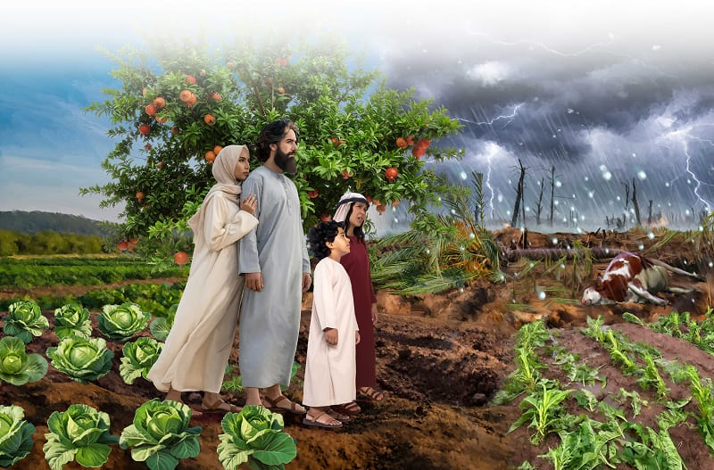

{"style":{"block":{"padding":{"start":"none","end":"none"},"rounded":false},"wrapper":{"padding":{"start":"none","end":"none"}},"image":{"aspectRatio":1.778}}}


Moses bent over the fireplace and filled his hands with black burnt ash. Taking the handful, he walked into Pharaoh’s palace once again. Moses tossed the ashes into the air, just as God had told him to do. The ashes spread like fine dust throughout Egypt, causing skin sores called boils.

The boils were big and red, and they hurt a lot! Everyone, including Pharaoh and his magicians, were covered in boils. Even their animals had boils! It would have been painful to sit, lie down, or even walk. But Pharaoh would not let the slaves go.

So God decided to send a big hailstorm. Because of His great love, God warned the Egyptians to bring their animals and servants inside to a safe place so they wouldn’t get hurt. Did they listen? **Read Exodus 9:20, 21.**

After all that had happened, some Egyptians chose to believe and obey God, while others still ignored His words of warning. How sad. God loved the Egyptians, and He wanted to save them too. He wants everyone in the world to know, “The Lord your God in your midst, the Mighty One, will save” (Zephaniah 3:17).

Moses raised his rod into the air. With a rumble and crash God sent thunder, hail, and lightning from the sky. Big icy balls of hail crashed and smashed all the plants and trees. But not a single hailstone fell on the land of Goshen, where the Israelites lived. God protected them and the Egyptians who had followed God’s instructions.

^[I Wonder]({"style": {"text": {"typeface": "DKWhaleSong-Regular", "color": "#F79A83", "size": "lg"}}})

- Do you think you would have listened to the warning about the coming storm? Why?

^[Prayer Idea]({"style": {"text": {"typeface": "DKWhaleSong-Regular", "color": "#F79A83", "size": "lg"}}})\
Thank God for His great love and that He gives everyone the chance to be saved.

^[Do]({"style": {"text": {"typeface": "DKWhaleSong-Regular", "color": "#F79A83", "size": "lg"}}})\
Go for a search through the house for things that provide protection: hat, sunglasses, scarf, oven mitts, etc. What would happen if we didn’t use these items? God gave the Egyptians the option to be protected.

```=Memory Verse

“The Lord your God in your midst, the Mighty One, will save” (Zephaniah 3:17).

```