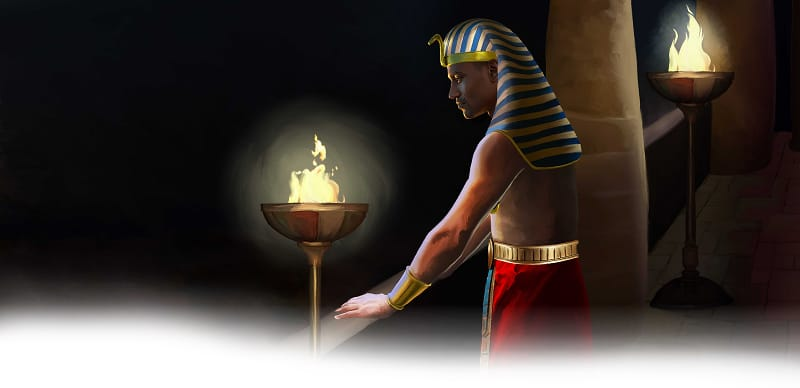

{"style":{"block":{"padding":{"start":"none","end":"none"},"rounded":false},"wrapper":{"padding":{"start":"none","end":"none"}},"image":{"aspectRatio":1.778}}}


Moses stared at the stubborn pharaoh and frowned. _When would he obey God?_

Our mighty God had turned a river into blood, and sent lots and lots of frogs. He’d sent itchy lice, an animal sickness, sore boils, and a very scary hailstorm. Now God sent Moses and Aaron to ask Pharaoh, “How long will you refuse to humble yourself before Me? Let My people go” (Exodus 10:3).

Then another warning was given. This time God would send hopping insects called locusts. Pharaoh still wouldn’t let all the people go. So God caused a strong wind to blow. The wind carried dark clouds of hungry locusts. There were so many locusts that the sky turned dark. What did they do? **Read Exodus 10:15.**

After the locusts Moses raised his hand again. Suddenly darkness covered the Egyptians’ land like a thick blanket. For three days “no one could see anyone else” (Exodus 10:23, ICB). They couldn’t see the glow of stars or the shining moon. They couldn’t even see to light a candle. They could only sit and think.

God used this pitch blackness like a timeout. God wanted the Egyptians to think about His mighty power, and to ask Him to change their hearts. God wants to forgive and change us too! “The Lord your God in your midst, the Mighty One, will save” (Zephaniah 3:17).

^[I Wonder]({"style": {"text": {"typeface": "DKWhaleSong-Regular", "color": "#21A0A9", "size": "lg"}}})

- What do you think the Egyptians thought about while they sat in complete darkness?

^[Do]({"style": {"text": {"typeface": "DKWhaleSong-Regular", "color": "#21A0A9", "size": "lg"}}})\
Go for a nighttime walk outside, or make a room inside dark. What can you see/can’t you see? Take a flashlight with you and think about how the Bible is like light, showing us God’s love and how to live for Him.

^[Prayer Idea]({"style": {"text": {"typeface": "DKWhaleSong-Regular", "color": "#21A0A9", "size": "lg"}}})\
Ask God to help you draw close to Him by reading the Bible, God’s lamp.

```=Memory Verse

“The Lord your God in your midst, the Mighty One, will save” (Zephaniah 3:17).

```

{"style": {"block": {"backgroundColor": "#B4B5B4", "padding": {"top": "sm", "start": "base", "end":"sm", "bottom": "sm"}}, "text": {"color": "#FFFFFF"}}}
^[Friday Night Family Activity]({"style": {"text": {"typeface": "DKWhaleSong-Regular", "size": "lg"}}})\
On the next blank space of the True Treasure Map, draw or glue something from this week’s story that reminds you that God is powerful to save. Talk about what it means to let Him save us from sin (believing in Him, telling Him our sins, and asking Him to help us walk in a new way).\
\
^[For You, Parents]({"style": {"text": {"typeface": "DKWhaleSong-Regular", "size": "lg"}}})\
“Learn to go to him who is mighty to save. He knows what you need before you ask him; but he has made this your duty, and the duty of every one of us, to come to him and ask him in confidence for what we need” (Ellen G. White, _An Appeal to the Youth_, p. 55).