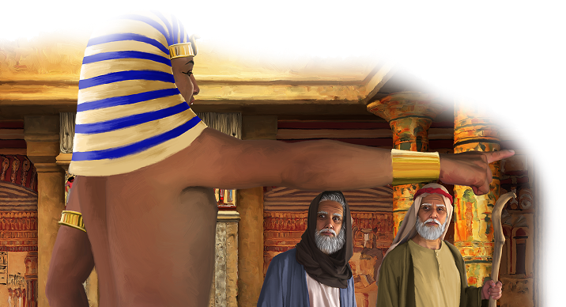

{"style":{"block":{"padding":{"start":"none","end":"none"},"rounded":false},"wrapper":{"padding":{"start":"none","end":"none"}},"image":{"aspectRatio":1.778}}}

{"style": {"text": {"typeface": "DKWhaleSong-Regular", "color": "#00929C", "size": "xl"}}}
**Big Idea:**\
God’s way is best. I am saved by trusting Him.

**^[Memory Verse]({"style": {"text": {"typeface": "DKWhaleSong-Regular", "size": "lg"}}})**\
_^[“You are my hiding place; You shall preserve me from trouble”]({"style": {"text": {"color": "#00929C"}}})_ (Psalm 32:7).

**Word of the Week**\
_^[“Save”]({"style": {"text": {"color": "#00929C"}}})_ - To save is to keep safe, or to rescue from harm. God loves to keep us safe. Sin has hurt all people, and the world that we live in. God sent Jesus to save us from our sins; to do this, Jesus died on the cross.

**This week’s lesson**\
is based on Exodus 11; 12; 13:1-16; with insights from _Patriarchs and Prophets_, pp. 273-282.

{"style":{"block":{"padding":{"start":"none","end":"none"},"rounded":false},"wrapper":{"padding":{"start":"none","end":"none"}},"image":{"aspectRatio":1.778}}}

{"style": {"text": {"typeface": "DKWhaleSong-Regular", "color": "#A0BA3B", "size": "xl"}}}
Last Warning

Moses looked at the broken farms and smashed fields and sighed. Egypt was a mess! If only Pharaoh would listen to God and let God’s people go!

God had given the Egyptians nine warnings, called plagues. Can you remember all of them?

1. God turned water into ________.
2. God sent jumping, hopping, croaking ________.
3. God sent itchy, biting ________.
4. God sent flying, buzzing, biting ________.
5. God sent a sickness for all the clip-clopping, grass-gobbling ________.
6. God sent ouchy, red skin ________.
7. God sent crashing, smashing, icy balls of ________.
8. God sent jumping, munching, flying ________.
9. God sent black, black ________.

Even after _all_ these warnings, Pharaoh still refused to let the Israelite slaves go! But God had a plan. He would send one final plague. Then what did God say would happen after this plague? **Read Exodus 11:1.**

Moses rushed to give Pharaoh this last warning. If Pharaoh didn’t free the Israelites, the firstborn child in every family would die that very night. This was Pharaoh’s last chance to obey God. But once again, Pharaoh “did not let the children of Israel go out of his land” (Exodus 11:10).

Even though a terrible last plague was coming, God had a plan to save everyone who trusted Him. He had warned the people. And now, with Moses’ help, He would tell them exactly how to be saved.

^[I Wonder]({"style": {"text": {"typeface": "DKWhaleSong-Regular", "color": "#C393C2", "size": "lg"}}})

- What did God do that showed He still loved Pharaoh and the Egyptian people?

^[Prayer Idea]({"style": {"text": {"typeface": "DKWhaleSong-Regular", "color": "#C393C2", "size": "lg"}}})\
Thank God for His patience. Thank Him for not giving up on teaching you.

^[Do]({"style": {"text": {"typeface": "DKWhaleSong-Regular", "color": "#C393C2", "size": "lg"}}})\
Look out for road signs this week. Ask an adult why they are there and what they are saying.