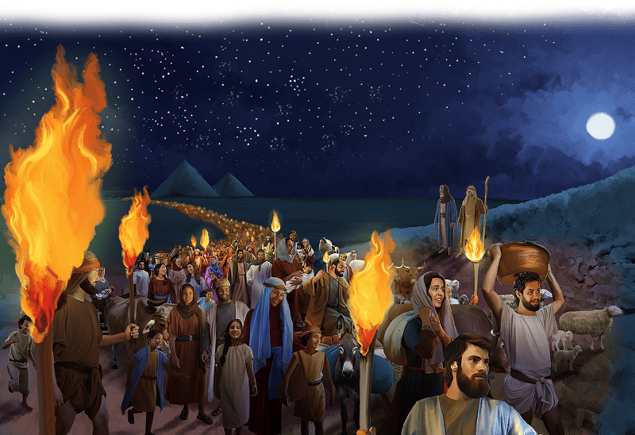

{"style":{"block":{"padding":{"start":"none","end":"none"},"rounded":false},"wrapper":{"padding":{"start":"none","end":"none"}},"image":{"aspectRatio":1.778}}}


The Israelites waited eagerly and quietly for Moses and Aaron to return. What had the king of Egypt said? What would be his orders? To stay or leave? To be slaves or free? All they knew is that God had promised them that they would go free.

They had checked off all their jobs. Family, check. Sandals, check. Staff, check. Sheep and cattle, check, check. They had been in such a rush, there wasn’t even time “to get food ready for their trip” (Exodus 12:39, ICB).

Sure enough, before the sun rose, the wonderful news came. Pharaoh had told them to get up and leave. They were free!

All 600,000 men, their wives, children, Egyptian friends, and animals began their journey out of Egypt into “the desert toward the Red Sea” (Exodus 13:18, ICB). Together they marched out of Egypt toward a promised land of freedom.

Who led the people out of Egypt? **Read Exodus 12:51.**

Imagine their excitement! Their hearts must have filled with praise to God, who had saved them from slavery. Never again would they be hurt by the mean Egyptian soldiers. Never again would Pharaoh force them to work or treat them badly.

^[I Wonder]({"style": {"text": {"typeface": "DKWhaleSong-Regular", "color": "#21A0A9", "size": "lg"}}})

- Have you ever had to move out of your house? How did this make you feel?
- How do you think the Israelites felt leaving Egypt?

^[Prayer Idea]({"style": {"text": {"typeface": "DKWhaleSong-Regular", "color": "#21A0A9", "size": "lg"}}})\
Thank God that His way is best and that you can trust Him.

^[Do]({"style": {"text": {"typeface": "DKWhaleSong-Regular", "color": "#21A0A9", "size": "lg"}}})\
Make a paper chain. Cut thin strips of paper then loop them in circles through each other. Fix each loop together with glue/stapler/tape. Have a family member hold the chain across a doorway while you run through it and break it. Hooray! As slaves, the Israelites were, in a sense, locked up in chains. But now they were free!

```=Memory Verse

“You are my hiding place; You shall preserve me from trouble” (Psalm 32:7).

```