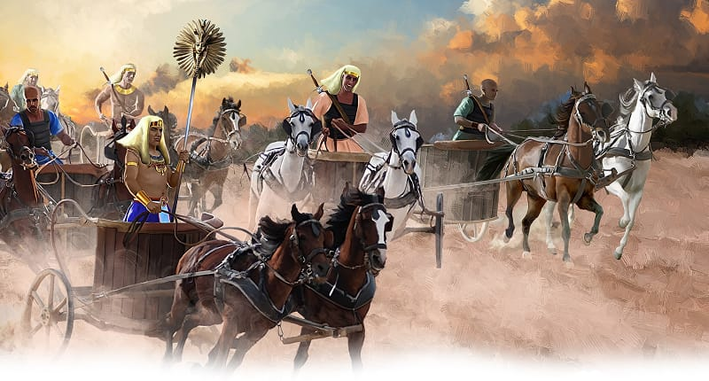

{"style":{"block":{"padding":{"start":"none","end":"none"},"rounded":false},"wrapper":{"padding":{"start":"none","end":"none"}},"image":{"aspectRatio":1.778}}}


As the sun came up the people rolled up their beds and packed up their tents. They watched the cloud and waited. God had been leading them through a hot desert for a while now. Where are we going? they wondered.

The tall cloud began to move. Quickly all the people and the animals began to follow. God’s cloud took them to the shores of the Red Sea. Here the cloud stopped, and the people stopped too. The Israelites set up their tents to camp by the seashore.

Back in Egypt, Pharaoh was angry and getting angrier! His slaves were long gone, and he and his rulers wanted them back. They said, “What have we done? We have let the people of Israel leave. We have lost our slaves!” (Exodus 14:5, ICB).

What did Pharaoh do? **Read Exodus 14:6.**

He was ready to bring those slaves back! The angry king also took 600 of his best chariots and horses, as well as all the other chariots in Egypt. They must have looked very powerful.

The Egyptian soldiers thundered down the road as fast as their horses could gallop. They must not let the Israelites get away! They must bring them back to Egypt.

But Pharaoh had once again forgotten one very important fact: the one true God was with the Israelites. His power was far greater than all the soldiers, chariots, and horses in the whole world. The Bible says, “Some trust in chariots, and some in horses; but we will remember the name of the Lord our God” (Psalm 20:7).

^[I Wonder]({"style": {"text": {"typeface": "DKWhaleSong-Regular", "color": "#C393C2", "size": "lg"}}})

- Why do you think Pharaoh had forgotten so quickly about the God who could do the impossible?

^[Prayer Idea]({"style": {"text": {"typeface": "DKWhaleSong-Regular", "color": "#C393C2", "size": "lg"}}})\
Ask God to help you remember to always trust in Him.

^[Do]({"style": {"text": {"typeface": "DKWhaleSong-Regular", "color": "#C393C2", "size": "lg"}}})\
Have a “chariot” race. Get down on all fours, then have a parent hold up your back legs so you are walking on your hands. You’re now a “chariot.” See how fast you can go on your hands. Remember that God is more powerful than anything!

^[Mission Challenge]({"style": {"text": {"typeface": "DKWhaleSong-Regular", "color": "#C393C2", "size": "lg"}}})\
Be extra loving to your mommy (or a wonderful woman who cares for you). Help her and be kind to her or draw her a nice picture. Give her lots of hugs.

```=Memory Verse

“Do not be afraid. Stand still, and see the salvation of the Lord” (Exodus 14:13).

```