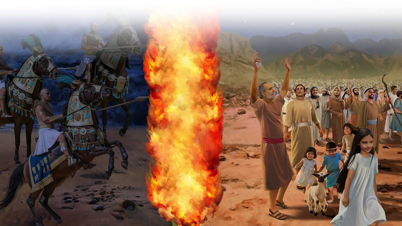

{"style":{"block":{"padding":{"start":"none","end":"none"},"rounded":false},"wrapper":{"padding":{"start":"none","end":"none"}},"image":{"aspectRatio":1.778}}}


The small cloud of dust in the distance grew bigger . . . and bigger . . . and bigger. The Israelites watched it carefully. It was coming toward them! What was it? They bent their necks forward, and tried to see. Chariots! Horses! Soldiers!

Oh, no, the Egyptian army was chasing after them! Where could they run? On one side of them stood tall, rocky mountains, and in front of them lay the deep Red Sea. There was nowhere to go—they were trapped! Afraid, they began crying out to God for help.

In a calm voice Moses told them, “Do not be afraid. Stand still and see the salvation of the Lord. . . . The Lord will fight for you, and you shall hold your peace” (Exodus 14:13, 14).

They could trust God—He would fight for them and save them!

Suddenly God’s tall cloud started moving. It rose high into the air, floated over the Israelites, and came down right between God’s people and the Egyptian soldiers. Why did God move the cloud? **Read Exodus 14:20.**

Throughout the night God’s cloud stood between the two groups. On the Israelites’ side God’s fire shone with the warmth and brightness of day. But on the other side it was all dark. God had hidden His people from their enemies!

{"style": {"block": {"backgroundColor": "#EFE8D8", "padding": {"top": "sm", "start": "base", "end":"sm", "bottom": "sm"}}}}
^[Parent Faith Talk]({"style": {"text": {"typeface": "DKWhaleSong-Regular", "color": "#00929C", "size": "lg"}}})\
Share a time you were in an impossible situation and God stepped in to help or save you.

^[I Wonder]({"style": {"text": {"typeface": "DKWhaleSong-Regular", "color": "#8AC3A7", "size": "lg"}}})

- How would the Israelites have felt seeing God’s cloud protecting them?
- Why was Moses calm even though they were trapped?

^[Prayer Idea]({"style": {"text": {"typeface": "DKWhaleSong-Regular", "color": "#8AC3A7", "size": "lg"}}})\
Ask God to help you remember that He is close when you need Him most.

^[Do]({"style": {"text": {"typeface": "DKWhaleSong-Regular", "color": "#8AC3A7", "size": "lg"}}})\
Draw a big, tall cloud and cut it out. Stick on balls of cotton, yarn, or scrunched-up white paper. Hold the cloud in the air and walk around your house, talking about how amazing it would have been to follow God as He led the Israelites.

```=Memory Verse

“Do not be afraid. Stand still, and see the salvation of the Lord” (Exodus 14:13).

```