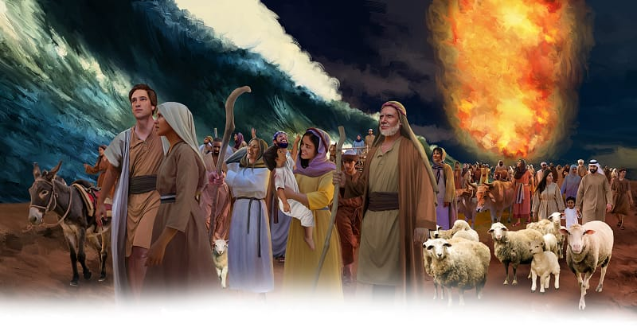

{"style":{"block":{"padding":{"start":"none","end":"none"},"rounded":false},"wrapper":{"padding":{"start":"none","end":"none"}},"image":{"aspectRatio":1.778}}}


All night God’s giant fiery pillar hid the Israelites from Pharoah’s army. But that wasn’t the only thing God had planned. He was about to do something even more amazing.

God asked the Israelites to get their things and “to go forward” (Exodus 14:15). In faith, the Israelites marched down to the water’s edge.

“Then Moses stretched out his hand over the sea” (Exodus 14:21).

A strong wind began to blow and blow. The wind blew the water to the left and to the right. Higher and higher the water rose on each side, like a wall. It left a dry path, right through the middle of the Red Sea! God had done the impossible—again.

What did the Israelites do next? **Read Exodus 14:22.**

Can you imagine how they felt as they walked on the dry path between the two watery walls? Do you think you would have skimmed your hand through the water as you crossed to the other side? Would you have run, skipped, or walked slowly? Would you have watched for any curious fish?

The people marched quickly along the dry path to safety. God’s way out of this trouble was better than anything they could have imagined! They didn’t need to fight. They didn’t need to be afraid. They had just needed to trust Him, “Stand still, and see the salvation of the Lord” (Exodus 14:13).

^[I Wonder]({"style": {"text": {"typeface": "DKWhaleSong-Regular", "color": "#F79A83", "size": "lg"}}})

- How would you have felt, walking or running across the Red Sea on a dry path? Why?

^[Prayer Idea]({"style": {"text": {"typeface": "DKWhaleSong-Regular", "color": "#F79A83", "size": "lg"}}})\
Thank God that His way is best and that you can trust Him.

^[Do]({"style": {"text": {"typeface": "DKWhaleSong-Regular", "color": "#F79A83", "size": "lg"}}})\
Draw Moses on a craft stick or plastic spoon. Fill a bowl with water and sprinkle with black pepper. Dip the bottom of the Moses stick/spoon into dish soap, then dip the stick/spoon into the middle of the water bowl. Watch in amazement as the black pepper immediately separates to each side of the bowl, just as the sea waves made way for the Israelites.

```=Memory Verse

“Do not be afraid. Stand still, and see the salvation of the Lord” (Exodus 14:13).

```