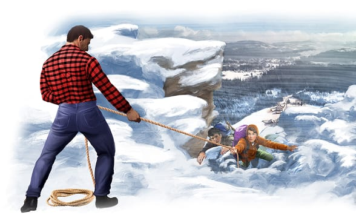

{"style":{"block":{"padding":{"start":"none","end":"none"},"rounded":false},"wrapper":{"padding":{"start":"none","end":"none"}},"image":{"aspectRatio":1.778}}}

Alan and Vince smiled as they looked out at the view from high up on the mountain. The two cousins had climbed up the rocky, snowy mountain together. The view was beautiful!

“Hey, Vince, we’d better be getting back,” said Alan finally. “It’s almost 5:00 p.m.”

Vince agreed. As they walked back down the steep path, the clouds became thicker. It was cold, and getting colder.

Suddenly Alan slipped! He fell onto ice and began to slide down the hill.

Quickly Vince tried to reach out and help him, but he slipped too! Whoosh, down the hill they slid, closer and closer to a cliff.

Just before the cliff was a big rock. The cousins reached out and grabbed it. They came to a stop just in time. But now they were stuck. It was too slippery to climb up, and below them was a cliff.

“Dear God,” prayed Vince, “if You’re there, please do something for us. Show us how to get off this mountain safely.”

Just then the boys heard a voice at the top of the icy hill. “Hello! Are you in trouble there?”

At the top of the hill was a tall man, dressed in a bright red-and-black-checkered shirt and jeans. He had a rope over his shoulder and thick hiking boots on his feet. The boys told him what had happened. Carefully he made his way down toward them. “Now, just hold tight, and I’ll get you across this snowfield,” he said kindly. Carefully he led them to safety.

With his feet on solid ground, Alan sighed, “Whew, what a relief.” Vince turned to thank the helpful man. But where was he?

The man had completely disappeared! There was no sign of him at all. Alan and Vince knew then that God had saved them. He had sent His angel to do an impossible miracle.

Whenever you need help, remember God is only a prayer away. “Do not be afraid. Stand still, and see the salvation of the Lord” (Exodus 14:13).

---

{"style": {"text": {"size": "sm"}}}
This story is adapted from “Discovery on the Mountainside” by Elaine Egbert, _Guide’s Greatest Angel Stories_, copyright © 2013, published by the Review and Herald® Publishing Association. Used and adapted by permission.