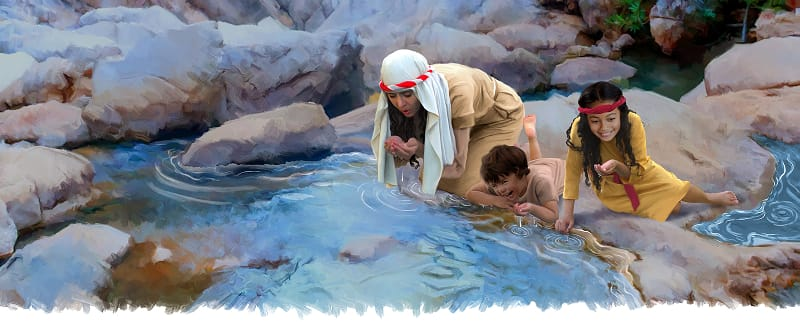
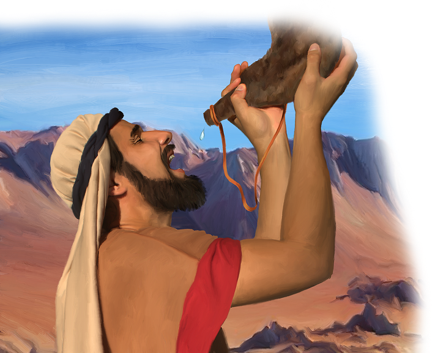

{"style":{"block":{"padding":{"start":"none","end":"none"},"rounded":false},"wrapper":{"padding":{"start":"none","end":"none"}},"image":{"aspectRatio":1.778}}}

{"style": {"text": {"typeface": "DKWhaleSong-Regular", "color": "#00929C", "size": "xl"}}}
**Big Idea:**\
God’s way is best. I will be thankful to Him.

**^[Memory Verse]({"style": {"text": {"typeface": "DKWhaleSong-Regular", "size": "lg"}}})**\
_^[“Oh, give thanks to the Lord, for He is good! For His mercy endures forever”]({"style": {"text": {"color": "#00929C"}}})_ (Psalm 136:1).

**Word of the Week**\
_^[“Thankful”]({"style": {"text": {"color": "#00929C"}}})_ - When we are thankful, we are happy or pleased because of something. We feel and want to show our thanks. We can be thankful for water to drink and food to eat. We can be thankful for God, who gives us all things because He loves us.

**This week’s lesson**\
is based on Exodus 15:22-27 and 17:1-7; and _Patriarchs and Prophets_, pp. 291-298.

{"style":{"block":{"padding":{"start":"none","end":"none"},"rounded":false},"wrapper":{"padding":{"start":"none","end":"none"}},"image":{"aspectRatio":1.778}}}

{"style": {"text": {"typeface": "DKWhaleSong-Regular", "color": "#A0BA3B", "size": "xl"}}}
We’re Thirsty!

Boys and girls sang as they skipped along the dusty path. Their parents sang too as they walked behind. Everyone smiled as they sang, “He has thrown the horse and its rider into the sea.” Yes! God had saved them all from the Egyptian army. What a wonderful miracle the Israelites had seen—God had made a dry path through the Red Sea!

As they walked safely on, the Israelites kept singing and saying thank You to God. Freedom felt so wonderful. They never wanted to forget this day. They would remember God’s mighty, saving power forever!

The new land they had crossed into was hot and dry. The sun beat down on their backs as they walked. There was no green grass or leafy trees in this desert. But God was with them. His cloud gave them shade from the hot sun and it also led them on.

For three long days the Israelites walked across the hot desert but “found no water” (Exodus 15:22). There was not a single drop of rain, not a tiny puddle or trickling creek. The water they had carried with them was now gone, and their throats were dry. They really, really wanted a drink. It was all they thought and talked about.

What had they already forgotten to do? **Read 1 Chronicles 16:8.**

God had been so good to them already. If they remembered His mighty miracles, it would help them be thankful. With thankful hearts, we can trust God to help us again. The Bible says, “Oh, give thanks to the Lord, for He is good! For His mercy endures forever” (Psalm 136:1).

^[I Wonder]({"style": {"text": {"typeface": "DKWhaleSong-Regular", "color": "#C393C2", "size": "lg"}}})

- Have you ever wanted something so bad (a toy, a treat, to go somewhere) that it was all you thought and talked about? What was it?
- What might you try to remember next time?

^[Prayer Idea]({"style": {"text": {"typeface": "DKWhaleSong-Regular", "color": "#C393C2", "size": "lg"}}})\
Ask God to help you to have a thankful heart.

^[Do]({"style": {"text": {"typeface": "DKWhaleSong-Regular", "color": "#C393C2", "size": "lg"}}})\
Throw a ball to each other. Each time you catch the ball, say something you are thankful to God for.