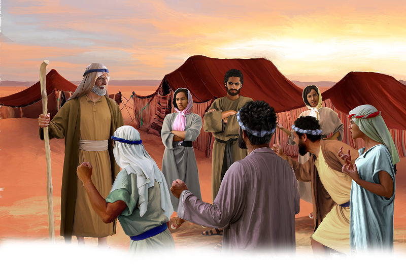

{"style":{"block":{"padding":{"start":"none","end":"none"},"rounded":false},"wrapper":{"padding":{"start":"none","end":"none"}},"image":{"aspectRatio":1.778}}}


As day faded into night, God’s tower of fire lit up the sky. It glowed through the night, keeping the people warm and safe. Then, as the golden sun rose, the people looked up to see God’s cloud above them. It gave them shade from the burning sun. They followed the cloud “from place to place as the Lord commanded” (Exodus 17:1, ICB).

One day God’s cloud came to a stop. Here the people set up camp again. But there was one problem. There was no water.

“Give us water to drink,” the Israelites moaned to Moses. Only a little time had passed, and here they were again, thirsty, grumpy, and angry at Moses.

“Why do you quarrel with me?” asked Moses (Exodus 17:2, ICB).

The people grumbled in reply. They asked Moses if he had brought them into the desert to die from thirst. Of course, he hadn’t! They should have remembered it was God who had brought them out of Egypt. And it was God who promised to protect and bless them.

The people grumbled some more. They had forgotten God’s miracle water. They’d even forgotten just how special it was to have God’s tower of fire and big cloud with them.

The Bible says, “Oh, give thanks to the Lord, for He is good! For His mercy endures forever” (Psalm 136:1). But they weren’t thankful. Their complaining words grew louder and louder.

**What does Proverbs 17:22 say about different attitudes?** Which one will you choose to have today?

{"style": {"block": {"backgroundColor": "#EFE8D8", "padding": {"top": "sm", "start": "base", "end":"sm", "bottom": "sm"}}}}
^[Fast Fact]({"style": {"text": {"typeface": "DKWhaleSong-Regular", "color": "#00929C", "size": "lg"}}})\
People can survive for only three days without water. We need water every day to live. Count how many cups of water you drink today.

^[I Wonder]({"style": {"text": {"typeface": "DKWhaleSong-Regular", "color": "#7994CC", "size": "lg"}}})

- Do you sometimes find yourself grumbling and complaining?
- Does complaining fix the problem? Does it make you feel any better?
- What should we try to do instead of complaining?

^[Prayer Idea]({"style": {"text": {"typeface": "DKWhaleSong-Regular", "color": "#7994CC", "size": "lg"}}})\
Ask God to fill your heart and your words with thankfulness.

^[Do]({"style": {"text": {"typeface": "DKWhaleSong-Regular", "color": "#7994CC", "size": "lg"}}})\
Give each family member three clips or clothespins to put onto their clothes. Then look for ways to say thank you to each other throughout the day. After thanking someone, clip one of your clips onto their clothes. The winners are the people with no clips on their clothes at the end of the day.

```=Memory Verse

“Oh, give thanks to the Lord, for He is good! For His mercy endures forever” (Psalm 136:1).

```