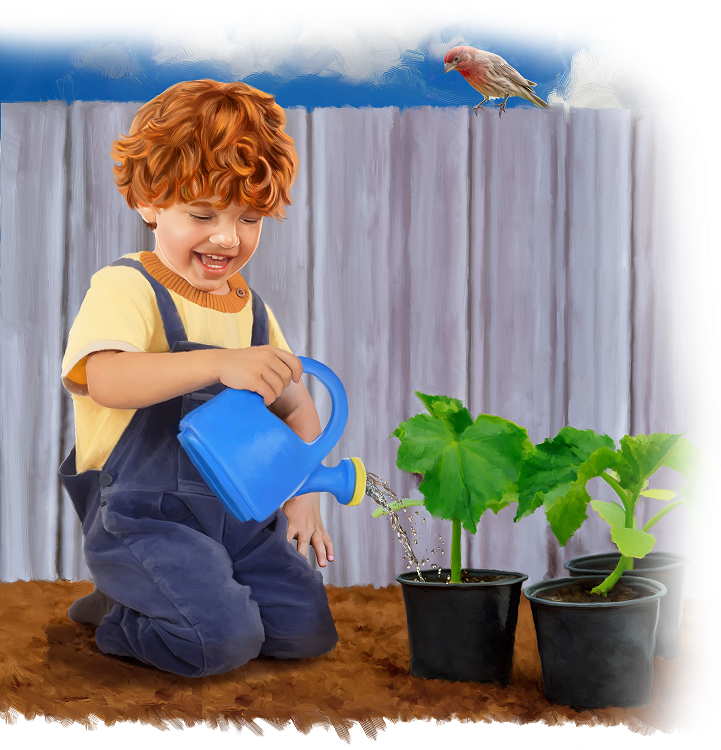
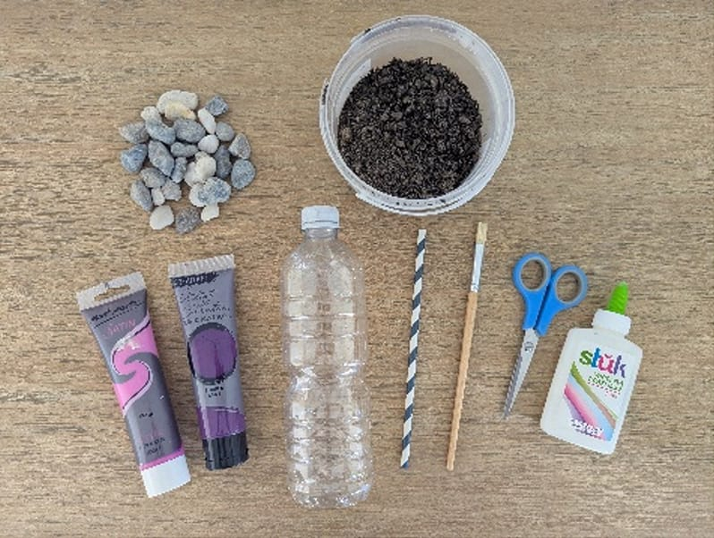
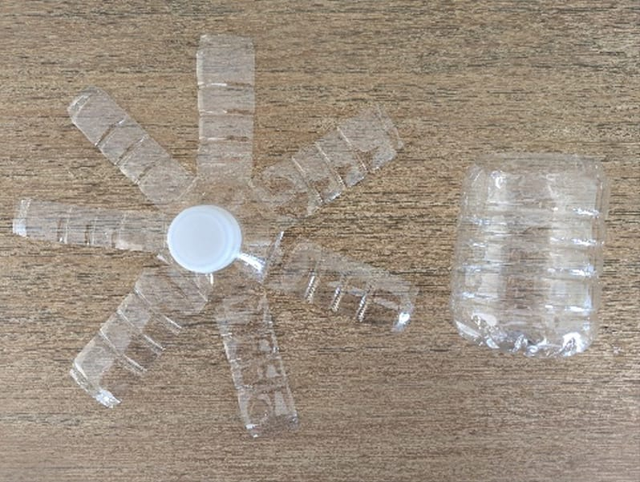
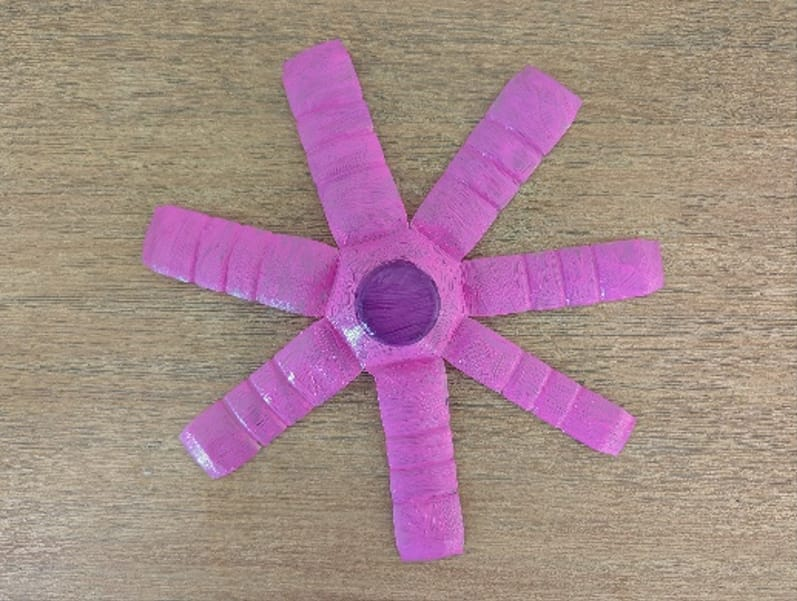
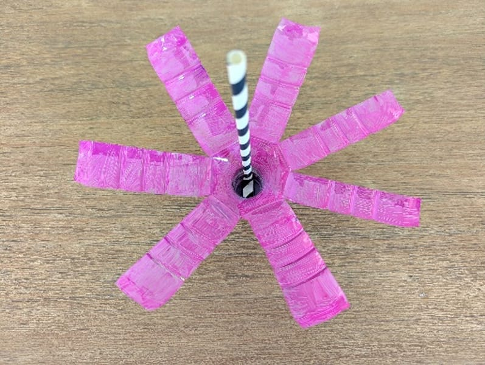
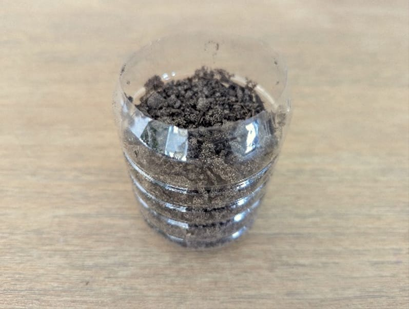
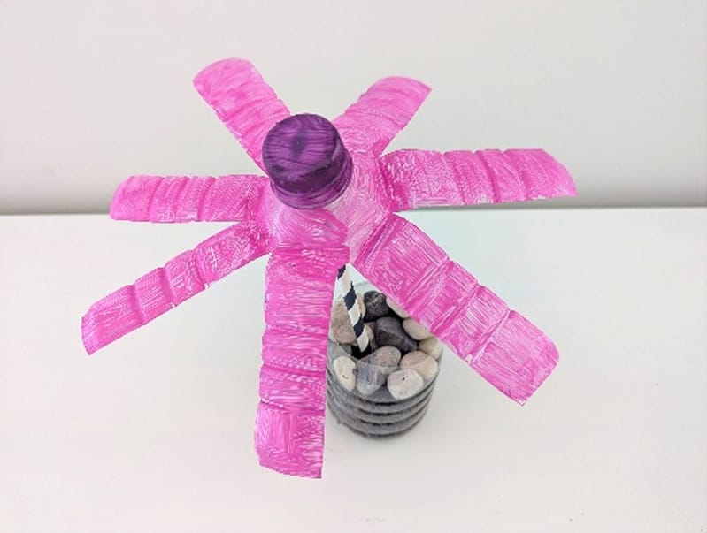

{"style":{"block":{"padding":{"start":"none","end":"none"},"rounded":false},"wrapper":{"padding":{"start":"none","end":"none"}},"image":{"aspectRatio":1.778}}}

You are like a little seed, and God’s love is like the water. When you soak up God’s love each day, by praying, singing worship songs, and reading your Bible, God helps you grow. God knows that when we are thankful, we will grow bigger, stronger, and more beautiful. The Bible says, “Oh, give thanks to the Lord, for He is good! For His mercy endures forever” (Psalm 136:1).

{"style": {"text": {"typeface": "DKWhaleSong-Regular", "color": "#00929C", "size": "xl"}}}
**CRAFT: Thank-You Flowers**

Follow the instructions below to make a water bottle flower as a reminder to grow in thankfulness.

1\. Cut a water bottle in half. To create petals, cut slits about an inch wide in the top half of the bottle (around the lid). Bend the “petals” outward.

2\. Decorate the ”petals” by painting them or gluing material on.

3\. Glue the straw or stick “stem” into the lid. Glue scrap paper or material inside the lid to create extra stability for the stem, if needed.

4\. Pour dirt or sand into the other half of the water bottle.

5\. Push the flower stem into the newly created vase. Add extra rocks or dirt to create more stability, if needed.

