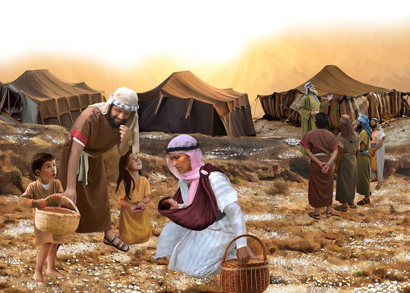

{"style":{"block":{"padding":{"start":"none","end":"none"},"rounded":false},"wrapper":{"padding":{"start":"none","end":"none"}},"image":{"aspectRatio":1.778}}}


As the warm sun rose the next morning, the Israelites jumped out of bed with excitement. Quickly they peeked outside their tents. Lying on the ground all around their camp were teeny tiny white flakes. They were round and as small as seeds.

The people were puzzled. What did they ask each other? **Read Exodus 16:15 to fill in the blanks.**\
“________ ________ _______?”

With a big smile Moses told them, “This is the bread which the Lord has given to you to eat” (Exodus 16:15).

What an amazing miracle! God had sent them food from heaven. The people called it “manna.” They rushed to pick up the tiny pieces of manna. But God told them to collect only what they needed for the day. He promised to send new, fresh manna every morning! This daily manna miracle would be a wonderful reminder that God was their provider.

Taking the manna back to their tents, the people crushed the manna flakes between stones to make a powder, like flour. They then “cooked it in a pot or made cakes with it” (Numbers 11:8, ICB).

Happy sighs now filled the camp. _Mmm, yum!_ God’s miracle manna bread tasted “like wafers made with honey” (Exodus 16:31). Their tummies were filled, and their hearts were overflowing with thankfulness to God. He had provided them with food when they were hungry.

{"style": {"block": {"backgroundColor": "#EFE8D8", "padding": {"top": "sm", "start": "base", "end":"sm", "bottom": "sm"}}}}
^[Parent Faith Talk]({"style": {"text": {"typeface": "DKWhaleSong-Regular", "color": "#00929C", "size": "lg"}}})\
Share a time that God provided something for you that you needed.

^[I Wonder]({"style": {"text": {"typeface": "DKWhaleSong-Regular", "color": "#7994CC", "size": "lg"}}})

- Do you say grace before your meals? Why?

^[Prayer Idea]({"style": {"text": {"typeface": "DKWhaleSong-Regular", "color": "#7994CC", "size": "lg"}}})\
Thank God for the food He provides you with each day.

^[Do]({"style": {"text": {"typeface": "DKWhaleSong-Regular", "color": "#7994CC", "size": "lg"}}})\
Ask a parent or caregiver to cover up your eyes next mealtime and then serve you your food. You’ll need to guess: “What is it?” Thank God, and your parents/caregivers, for providing you with food.

^[Mission Challenge]({"style": {"text": {"typeface": "DKWhaleSong-Regular", "color": "#7994CC", "size": "lg"}}})\
Show or tell your cousins or uncles and aunts that you love them and that God loves them. If they live far away, call them this week to tell them.

```=Memory Verse

“You open Your hand and satisfy the desire of every living thing” (Psalm 145:16).

```