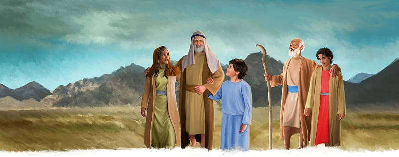

{"style":{"block":{"padding":{"start":"none","end":"none"},"rounded":false},"wrapper":{"padding":{"start":"none","end":"none"}},"image":{"aspectRatio":1.778}}}

{"style": {"text": {"typeface": "DKWhaleSong-Regular", "color": "#7994CC", "size": "xl"}}}
**Big Idea:**\
God’s way is best. He made families to love each other.

**^[Memory Verse]({"style": {"text": {"typeface": "DKWhaleSong-Regular", "size": "lg"}}})**\
_^[“Let all that you do be done with love”]({"style": {"text": {"color": "#00929C"}}})_ (1 Corinthians 16:14).

**Word of the Week**\
_^[“Family”]({"style": {"text": {"color": "#00929C"}}})_ - God made families. He made Adam the daddy and Eve the mommy. Adam and Eve had children as part of their family. Extended families can include grandparents, caregivers, aunties, uncles, and cousins. God gave us families so we could love and care for each other.

**This week’s lesson**\
is based on Exodus 18; and _Patriarchs and Prophets_, pp. 300, 301.

{"style":{"block":{"padding":{"start":"none","end":"none"},"rounded":false},"wrapper":{"padding":{"start":"none","end":"none"}},"image":{"aspectRatio":1.778}}}

{"style": {"text": {"typeface": "DKWhaleSong-Regular", "color": "#A0BA3B", "size": "xl"}}}
A Faraway Family

Moses sat down with a tired sigh. It had been a long day helping the people of Israel work out their problems. He smiled to see a stack of warm manna bread waiting for him. It was so nice to be cared for by his big family—brother Aaron, sister Miriam, their families, and his big tribe of Levi.

The bread was sweet. As he chomped and chewed, Moses may have thought of his own family. He had married Zipporah, the lovely daughter of Jethro, in Midian. They had two sons, Gershom and Eliezer. Together they worshipped the one true God.

When God had called Moses to return to Egypt, they went with him. But as they had walked together through the dusty desert, Moses had thought and thought. His people were still slaves in Egypt. _Would his family be safe there? Would they be happy?_ He knew Zipporah would feel very sad to see people being hurt in Egypt.

He decided to send his family back to their home, in Midian, for a while. Even though he would really miss them, it was the loving thing to do. The Bible says, “Let all that you do be done with love” (1 Corinthians 16:14).

Whom did they stay with? **Read Exodus 18:2.**

Moses must have been so glad that his family was safe, happy, and looked after. God had given him a family to love and protect. And God gives you parents and maybe an older brother or sister to love and care for us too.

^[I Wonder]({"style": {"text": {"typeface": "DKWhaleSong-Regular", "color": "#C393C2", "size": "lg"}}})

- Can you think of how the people in your family show love and care toward each other?

^[Prayer Idea]({"style": {"text": {"typeface": "DKWhaleSong-Regular", "color": "#C393C2", "size": "lg"}}})\
Thank God for the people in your special family.

^[Do]({"style": {"text": {"typeface": "DKWhaleSong-Regular", "color": "#C393C2", "size": "lg"}}})\
Stand together in a circle, and cross over arms and hold each other’s hands to make a human knot. Without letting go, try to untangle your arms. Families can work together to help and support each other.