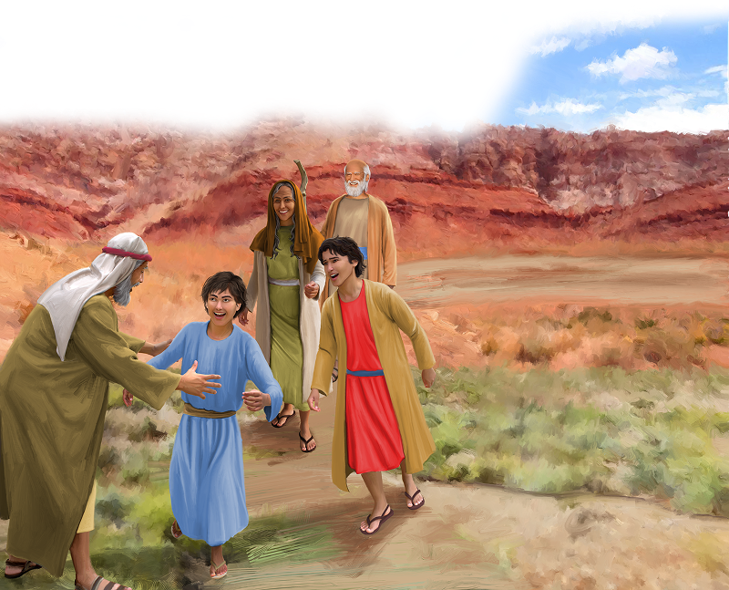
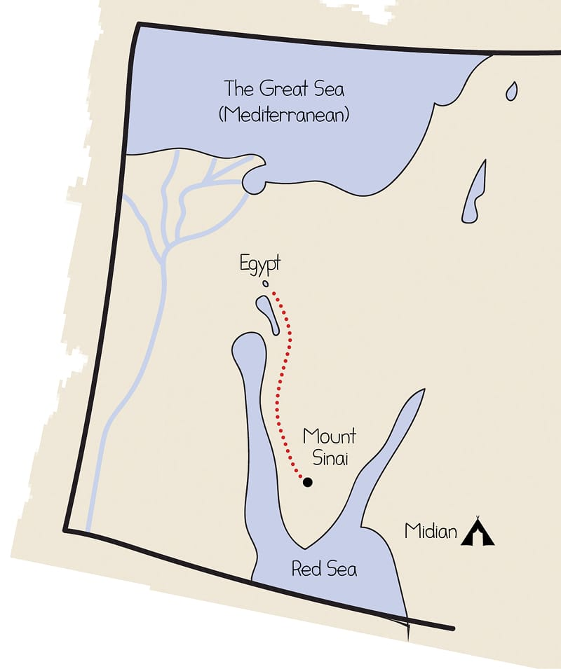

{"style":{"block":{"padding":{"start":"none","end":"none"},"rounded":false},"wrapper":{"padding":{"start":"none","end":"none"}},"image":{"aspectRatio":1.778}}}


Father Jethro clapped his hands in delight. He had just heard the best news! Quickly he called for his daughter Zipporah. He couldn’t wait to tell her—God had set His people, who were in Egypt, free! Moses had led them out of Egypt and into the desert near Mount Sinai. Moses was safe, and God’s people were safe. What happy news indeed!

Soon the family was all packed up. Jethro, Zipporah, Gershom, and Eliezer set off to find Moses. They couldn’t wait to see him!

It had been three months since Moses had led the Israelites out of Egypt, from Goshen. The Israelites had been on a big walking trip. On the map below, look at the path they may have followed from Egypt, through the Red Sea, and into the desert near Mount Sinai.

If you look closely, you’ll see a tent nearby, in Midian. That’s where Jethro lived. They weren’t far away from Moses, who was at Mount Sinai, at all! As they got closer, Jethro sent a message to Moses to let him know his family was on their way. What did Moses do? **Read Exodus 18:7.**

Imagine the big hugs and kisses Moses must have given his family. They were back together! God had promised Moses at the burning bush, “I will certainly be with you” (Exodus 3:12). He had looked after Moses and his family when they were together and when they were apart. He will look after your family wherever you are, and wherever you go too.

^[I Wonder]({"style": {"text": {"typeface": "DKWhaleSong-Regular", "color": "#C393C2", "size": "lg"}}})

- Have you ever missed a family member when they have been away or on a trip?
- What was it like to see them again? What did you do when you saw them?

^[Prayer Idea]({"style": {"text": {"typeface": "DKWhaleSong-Regular", "color": "#C393C2", "size": "lg"}}})\
Thank God that He is with you, looking after your family wherever you go.

^[Do]({"style": {"text": {"typeface": "DKWhaleSong-Regular", "color": "#C393C2", "size": "lg"}}})\
Ask your parents to help you draw a map of the area where your family lives. Mark your home. Draw in places you often go (school, church, park, grandparents’ house). Draw dotted lines to show your journeys. Thank Jesus that He “will go before you. He will be with you” (Deuteronomy 31:8, ICB).

{"style":{"block":{"padding":{"start":"none","end":"none"},"rounded":false},"wrapper":{"padding":{"start":"none","end":"none"}},"image":{"aspectRatio":1.778}}}


```=Memory Verse

“Let all that you do be done with love” (1 Corinthians 16:14).

```