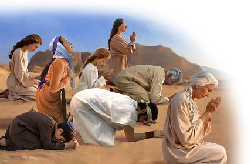

{"style":{"block":{"padding":{"start":"none","end":"none"},"rounded":false},"wrapper":{"padding":{"start":"none","end":"none"}},"image":{"aspectRatio":1.778}}}

{"style": {"text": {"typeface": "DKWhaleSong-Regular", "color": "#A0BA3B", "size": "xl"}}}
**Big Idea:**\
God’s way is best. I will put Him first.

**^[Memory Verse]({"style": {"text": {"typeface": "DKWhaleSong-Regular", "size": "lg"}}})**\
_^[“You shall love the Lord your God with all your heart, with all your soul, and with all your strength”]({"style": {"text": {"color": "#00929C"}}})_ (Deuteronomy 6:5).

**Word of the Week**\
_^[“Love”]({"style": {"text": {"color": "#00929C"}}})_ - Love is tender, kind, and unselfish, even to the people we don’t like. It doesn’t get angry easily, and forgives quickly. Love puts the other person first and wants what is best for them. God is love. He wants us to love Him and become like Him.

**This week’s lesson**\
is based on Exodus 20:1-11; and _Patriarchs and Prophets_, pp. 303-314.

{"style":{"block":{"padding":{"start":"none","end":"none"},"rounded":false},"wrapper":{"padding":{"start":"none","end":"none"}},"image":{"aspectRatio":1.778}}}

{"style": {"text": {"typeface": "DKWhaleSong-Regular", "color": "#7994CC", "size": "xl"}}}
The Message From God

The dirty clothes went into the bowl of water with a splash. Instantly the water turned a brown color—the same color as the desert. All over camp, people were busy washing and scrubbing their dusty clothes. They were getting ready for a very special meeting. God wanted to meet and speak with them!

The people got ready for two days; then Moses led them out of camp.

They stood together at the bottom of Mount Sinai. The Israelites could see God’s mighty presence as it covered the mountain with a cloud and fire.

They bowed down low before their loving, mighty God. Then “God spoke” (Exodus 20:1) to the Israelites. What was the first thing God told them? **Read Exodus 20:2.**

God wanted to remind them that He had saved them and that He loved them. Then He began to tell them His 10 special rules they should obey to live well. God knew that these rules would bring them closer to Him and help them to live happy lives. The rules would be a blessing to them and to others.

If they followed His rules of love, they “would live a long time,” and “all would go well” (Deuteronomy 6:2, 3, ICB). God would bless them, their children, their food, their work, their travels . . . everything! He would let everyone see that they were His special, loved people (Deuteronomy 28:1-14). The Israelites made a promise to God to obey His rules of love, and God promised to love and provide for them. This promise was like a marriage promise—forever together. God blesses all people who obey His rules of love—including you!

^[I Wonder]({"style": {"text": {"typeface": "DKWhaleSong-Regular", "color": "#8AC3A7", "size": "lg"}}})

- Why do you think God wanted to speak these words to the Israelite people Himself?
- How many of the Ten Commandments do you already know right now?

^[Prayer Idea]({"style": {"text": {"typeface": "DKWhaleSong-Regular", "color": "#8AC3A7", "size": "lg"}}})\
Thank God for His wise rules that keep us happy and safe.

^[Do]({"style": {"text": {"typeface": "DKWhaleSong-Regular", "color": "#8AC3A7", "size": "lg"}}})\
With help, look up the Ten Commandments song on the Alive in Jesus website and start learning it. Keep learning and singing it throughout the week.

!a[the-ten-commandments.mp3] “The Ten Commandments” {"credits":[{"key":"Writer","value":"Rosie Smith"}],"title": "Credits","copyright":"Copyright © 2025 General Conference Corporation® of Seventh-day Adventists."}