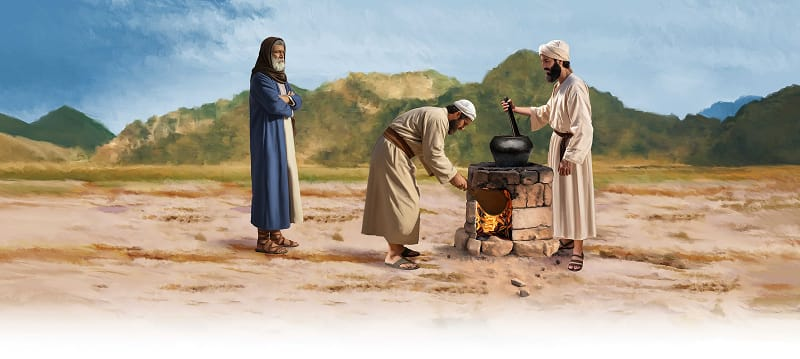
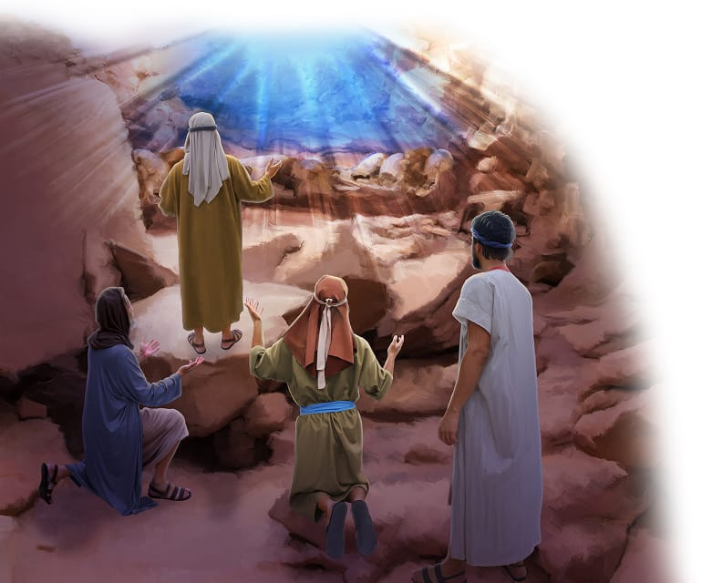

{"style":{"block":{"padding":{"start":"none","end":"none"},"rounded":false},"wrapper":{"padding":{"start":"none","end":"none"}},"image":{"aspectRatio":1.778}}}

{"style": {"text": {"typeface": "DKWhaleSong-Regular", "color": "#7994CC", "size": "xl"}}}
**Big Idea:**\
God’s way is best. I can choose Him.

**^[Memory Verse]({"style": {"text": {"typeface": "DKWhaleSong-Regular", "size": "lg"}}})**\
_^[“Teach me to do your will, for you are my God”]({"style": {"text": {"color": "#00929C"}}})_ (Psalm 143:10).

**Word of the Week**\
_^[“Choose”]({"style": {"text": {"color": "#00929C"}}})_ - To choose is to pick out something. If you have three games to choose from, you get to pick which one to play. To choose also means to decide to do something. God loves you so much that He lets you make choices. We can choose to follow God’s way, or not.

**This week’s lesson**\
is based on Exodus 24; 34; and _Patriarchs and Prophets_, pp. 315-330.

{"style":{"block":{"padding":{"start":"none","end":"none"},"rounded":false},"wrapper":{"padding":{"start":"none","end":"none"}},"image":{"aspectRatio":1.778}}}

{"style": {"text": {"typeface": "DKWhaleSong-Regular", "color": "#A0BA3B", "size": "xl"}}}
God’s Glowing Goodness

God called from the top of Mount Sinai, “Come up to me” (Exodus 24:1, ICB). He had just finished sharing the Ten Commandments. Now God wanted to do something special. Who did He invite up the mountain to be with Him? **Read Exodus 24:1.**

Imagine how excited the leaders must have felt! They climbed higher and higher and higher up the mountain.

Suddenly God appeared! His brightness and beauty, power and glory, shone like the sun. The leaders noticed His feet rested on sparkly blue sapphire stones. The stones were completely see-through, “like the very heavens” (Exodus 24:10) or the sky.

God’s goodness glowed all around them. He wanted to be close to them! They must have bowed down and worshipped Him.

“So they saw God, and they ate and drank” (Exodus 24:11). What a celebration! Surely this would be a day they would never forget.

One day, when Jesus comes again, “we shall see Him as He is” (1 John 3:2). We will see God in all His glory and holiness. What a day that will be!

^[I Wonder]({"style": {"text": {"typeface": "DKWhaleSong-Regular", "color": "#F79A83", "size": "lg"}}})

- Why do you think God wanted to show Himself in a special way to the Israelite leaders?
- What do you know or think God might look like?
- What might you do and say when you see Him?

^[Prayer Idea]({"style": {"text": {"typeface": "DKWhaleSong-Regular", "color": "#F79A83", "size": "lg"}}})\
Thank God that He wants to be close to you.

^[Do]({"style": {"text": {"typeface": "DKWhaleSong-Regular", "color": "#F79A83", "size": "lg"}}})\
Sing a song of praise to God with your family, such as “Praise Ye the Lord! Hallelujah!”
