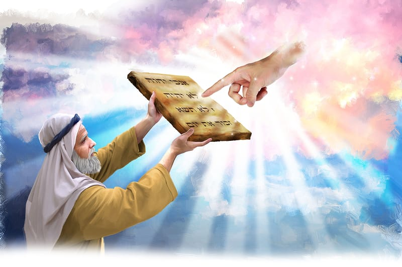

{"style":{"block":{"padding":{"start":"none","end":"none"},"rounded":false},"wrapper":{"padding":{"start":"none","end":"none"}},"image":{"aspectRatio":1.778}}}


Moses and the leaders ate and drank together, talking excitedly about all they had seen. They had seen God! Then God spoke to Moses again. “Come up to Me on the mountain and be there; and I will give you tablets of stone, and the law and commandments which I have written, that you may teach them” (Exodus 24:12).

Moses and helper Joshua began to climb even higher up Mount Sinai. There they waited. One day went by, two days went by, and still God didn’t speak. Finally, after seven days, God called to Moses from inside a thick cloud. He asked Moses to come even higher and closer to Him.

From the bottom of the mountain the Israelites saw the greatness of God over the mountain. What did this greatness look like to them? **Read Exodus 24:17.**

Moses stepped into the thick cloud. Yes, He would choose to come closer to God! Up and up he climbed, until he was with His loving God. For 40 days and 40 nights Moses and God talked together. What wonderful talks they must have had.

Then God made something special. Moses watched as God reached out with His own finger and wrote letters and words onto two big stones. These special words were the Ten Commandments. They would be a gift of love from God to everyone and would help the people know their loving God.

^[I Wonder]({"style": {"text": {"typeface": "DKWhaleSong-Regular", "color": "#C393C2", "size": "lg"}}})

- Why do you think God wrote the Ten Commandments with His own finger? And why in stone?
- What would you like to talk to God about? You can pray to Him anytime.

^[Prayer Idea]({"style": {"text": {"typeface": "DKWhaleSong-Regular", "color": "#C393C2", "size": "lg"}}})\
Thank God for the gift of His 10 rules of love.

^[Do]({"style": {"text": {"typeface": "DKWhaleSong-Regular", "color": "#C393C2", "size": "lg"}}})\
Use your finger to write a message of love in the dirt/sand/snow outside. Imagine seeing God write the Ten Commandments with His finger!

^[Mission Challenge]({"style": {"text": {"typeface": "DKWhaleSong-Regular", "color": "#C393C2", "size": "lg"}}})\
Show someone in your family what you’ve been learning about God’s laws of love. Use pictures or toys to help you.

```=Memory Verse

“Teach me to do your will, for you are my God” (Psalm 143:10).

```