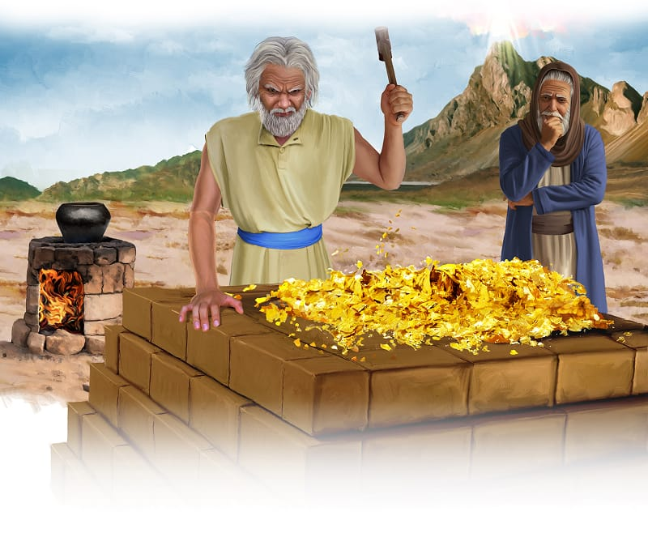

{"style":{"block":{"padding":{"start":"none","end":"none"},"rounded":false},"wrapper":{"padding":{"start":"none","end":"none"}},"image":{"aspectRatio":1.778}}}


Moses rushed toward the ugly golden idol. Filled with love for God, he picked it up and threw it into the fire. Whoosh! The hot flames wrapped around it, and the gold began to melt.

Moses took the melted metal out of the fire and crushed it into dust. Carrying the golden dust over to the nearby stream, he threw it into the water. Then he made the people drink it.

Moses stormed over to Aaron. What did he say to his brother? **Read Exodus 32:21.**

“Don’t be angry,” Aaron answered. “You know that these people are always ready to do wrong. The people said to me, ‘. . . make us gods who will lead us.’ . . . So they gave me the gold. I threw it into the fire and out came this calf!” (Exodus 32:22-24, ICB).

That wasn’t true! The golden calf hadn’t just made itself in the fire. Instead of telling Moses the truth, Aaron had lied. He had made up a pretend story, full of excuses.

If Aaron had chosen to stand up for what was right, this sinful mess would never have happened. God also asks you to “stand strong. Do not let anything move you. Always give yourselves fully to the work of the Lord” (1 Corinthians 15:58, ICB).

The idol was gone and the camp would soon be cleaned up too. But most of all, God wanted to give His people a clean heart.

^[I Wonder]({"style": {"text": {"typeface": "DKWhaleSong-Regular", "color": "#8AC3A7", "size": "lg"}}})

- How do we get a clean heart?
- What can you do to help you stand up for what’s right?

^[Prayer Idea]({"style": {"text": {"typeface": "DKWhaleSong-Regular", "color": "#8AC3A7", "size": "lg"}}})\
Thank God that He can give you a clean heart. Ask Him to help you always choose His way.

^[Do]({"style": {"text": {"typeface": "DKWhaleSong-Regular", "color": "#8AC3A7", "size": "lg"}}})\
Can you think of people in the Bible who chose God’s way even though everyone around them did the wrong thing? Act out their stories to your family, and have them guess who it is.

```=Memory Verse

“Teach me to do your will, for you are my God” (Psalm 143:10).

```