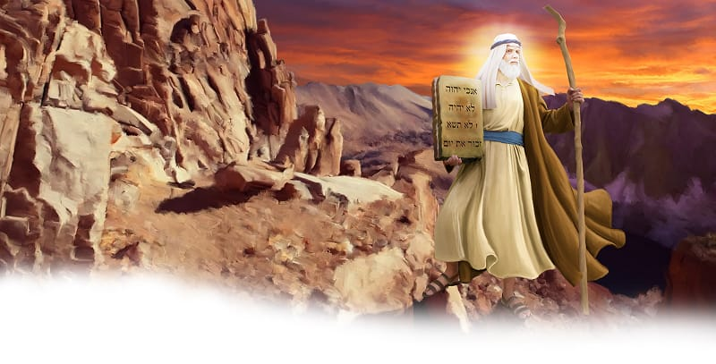

{"style":{"block":{"padding":{"start":"none","end":"none"},"rounded":false},"wrapper":{"padding":{"start":"none","end":"none"}},"image":{"aspectRatio":1.778}}}


The people of Israel sighed and cried. They had made a big mistake! They had worshipped an idol and broken their promise to God. They cried to God for forgiveness.

Meanwhile Moses began chiseling and hammering. He was making new flat stones. As the sun rose in the early-morning sky, Moses began his journey up Mount Sinai once again. Under his arms he held two empty stone tablets.

Up high on the mountain, God came to Moses. Would God forgive His people? “I am the Lord,” He said. “The Lord is a God who shows mercy and is kind. . . . The Lord forgives people for wrong and sin” (Exodus 34:6, 7, ICB). What a loving God!

For 40 days and nights God and Moses talked together again, as friends. God wrote the Ten Commandments on the stone tablets.

When God was finished, Moses carefully made his way back down the mountain with new Ten Commandments stones. But when the people saw Moses, they hid from him. Why? **Read Exodus 34:29, 30.**

Moses had been so close to God’s glowing goodness that his face glowed too!

God also wants you to come close to Him. When you do, others will notice. They won’t see light shining from your face, as the Israelites had seen from Moses’. But they may notice your sweet face, kind words, and loving actions. You can shine God’s love! Jesus says, “Let your light so shine before men, that they may see your good works and glorify your Father in heaven” (Matthew 5:16).

^[I Wonder]({"style": {"text": {"typeface": "DKWhaleSong-Regular", "color": "#7994CC", "size": "lg"}}})

- Will you choose to come closer to God today?

^[Prayer Idea]({"style": {"text": {"typeface": "DKWhaleSong-Regular", "color": "#7994CC", "size": "lg"}}})\
Thank God that He is kind, loving, and forgiving.

^[Do]({"style": {"text": {"typeface": "DKWhaleSong-Regular", "color": "#7994CC", "size": "lg"}}})\
Shine a flashlight under each other’s face as you sing “This Little Light of Mine.”

```=Memory Verse

“Teach me to do your will, for you are my God” (Psalm 143:10).

```

{"style": {"block": {"backgroundColor": "#B4B5B4", "padding": {"top": "sm", "start": "base", "end":"sm", "bottom": "sm"}}, "text": {"color": "#FFFFFF"}}}
^[Friday Night Family Activity]({"style": {"text": {"typeface": "DKWhaleSong-Regular", "size": "lg"}}})\
On the next blank space of the True Treasure Map, draw or glue something from this week’s story that reminds you that God’s way is best. Review the previous weeks.\
\
^[For You, Parents]({"style": {"text": {"typeface": "DKWhaleSong-Regular", "size": "lg"}}})\
“God requires his people to shine as lights in the world. It is not merely the ministers who are required to do this, but every disciple of Christ. Their conversations should be heavenly” (Ellen G. White, _Testimonies for the Church_, vol. 2, pp. 122, 123).