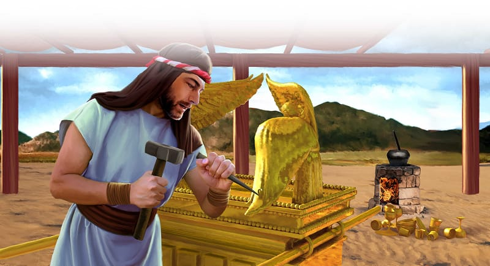

{"style":{"block":{"padding":{"start":"none","end":"none"},"rounded":false},"wrapper":{"padding":{"start":"none","end":"none"}},"image":{"aspectRatio":1.778}}}


God’s plan for His holy home, the sanctuary, was coming together perfectly. All the people were happy and excited. It was time for building to begin!

God knew just the right person to be in charge—Bezalel.

Bezalel was very good at making things. He could work with gold, silver, and bronze. He could cut stones and jewels, and turn rough wood into beautiful carved shapes. He could also sew and weave. And he was a very good teacher too. Why could he do all these things? **Read Exodus 35:31.**

God had said, “And let them make Me a sanctuary, that I may dwell among them” (Exodus 25:8). Bezalel was so happy to help! He and a team of makers began right away. God had given them special skills—things they were good at—called talents, given by God’s Spirit. They wanted to use their special talents for God.

All over camp, people began to look for ways to use their talents too. “And all the women whose hearts stirred with wisdom spun yarn [thread] of goats’ hair” (Exodus 35:26). Others colored different cloths. Some people who could run fast became messengers. Others, who were strong, carried heavy baskets. Even the leaders carried the special jewels. Everyone wanted to do what they were good at to help God.

The Holy Spirit has given you special talents too. You might make people laugh, learn things quickly, or be really good at sports. You may be good at listening, making things, or making people feel better. He gave you these talents so you could use them for good, to help Him.

Affirm your child for the special gifts and talents God has given them. Encourage them in simple ways to use them to help God and others.

{"style": {"block": {"backgroundColor": "#EFE8D8", "padding": {"top": "sm", "start": "base", "end":"sm", "bottom": "sm"}}}}
^[Parent Faith Talk]({"style": {"text": {"typeface": "DKWhaleSong-Regular", "color": "#00929C", "size": "lg"}}})\

^[I Wonder]({"style": {"text": {"typeface": "DKWhaleSong-Regular", "color": "#8AC3A7", "size": "lg"}}})

- If you were an Israelite, what part of God’s holy home would you have liked to help make?
- What things might you be good at?

^[Prayer Idea]({"style": {"text": {"typeface": "DKWhaleSong-Regular", "color": "#8AC3A7", "size": "lg"}}})\
Thank God for making you special and giving you talents.

^[Do]({"style": {"text": {"typeface": "DKWhaleSong-Regular", "color": "#8AC3A7", "size": "lg"}}})\
Prepare a notebook and pencil to take with you to church. On Sabbath, write or draw a list of all the helping, “doing” jobs you notice. For example, people singing, others taking up the offering. Tell these helpers, “Thank you for helping God.”

```=Memory Verse

“And let them make Me a sanctuary, that I may dwell among them” (Exodus 25:8).

```