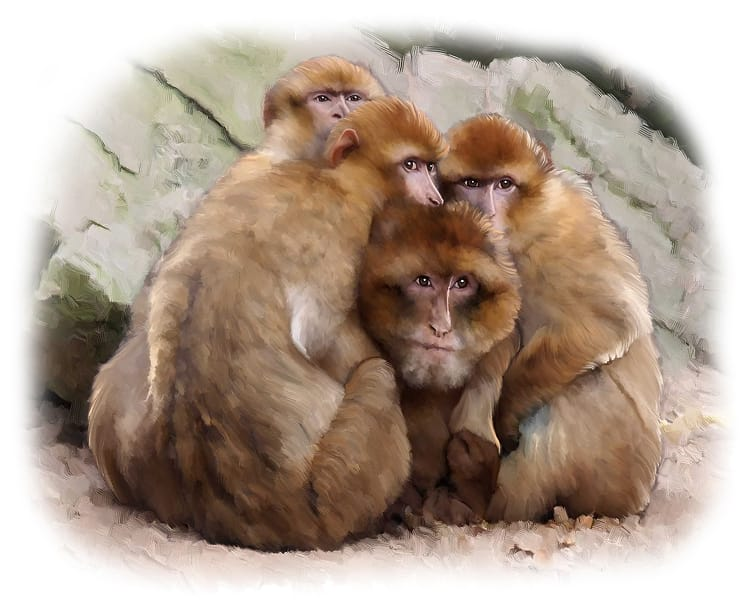

What do you like best about hugs? Do they make you feel loved, warm, and snuggly? Hugs are actually good for your health. They make you happier and calmer, and help you fight sickness. A cuddle a day just might keep the doctor away!

There are animals who have learned that hugs and staying close will help keep them alive and healthy.

**^[1. Emperor Penguins]({"style": {"text": {"color": "#6C6485"}}})**—These birds live in the icy cold land of Antarctica. They enjoy big group hugs to keep warm from the freezing winds that blow. The middle of the cuddly group is toasty warm. The penguins take turns being on the inside of the group hug to get warm. They then waddle to the outside of the hug circle to warm others up.

{"style":{"block":{"padding":{"start":"none","end":"none"},"rounded":false},"wrapper":{"padding":{"start":"none","end":"none"}},"image":{"aspectRatio":1.778}}}

**^[2. Golden Snub-nosed Monkeys]({"style": {"text": {"color": "#6C6485"}}})**—These monkeys live in the high mountain forests of China. These mountains become very cold during winter. The golden snub-nosed monkeys spend lots of time giving their family members big, long hugs to warm up.

{"style":{"block":{"padding":{"start":"none","end":"none"},"rounded":false},"wrapper":{"padding":{"start":"none","end":"none"}},"image":{"aspectRatio":1.778}}}

**^[3. Lions]({"style": {"text": {"color": "#6C6485"}}})**—These large cats are probably more known for their strength and loud roar. But lions also spend a lot of time cuddling close within their family. This is actually really important for their survival. Lions have to work closely together to get food and stay safe. Cuddles make everyone feel important and special and willing to do their part to protect and feed their family.

{"style":{"block":{"padding":{"start":"none","end":"none"},"rounded":false},"wrapper":{"padding":{"start":"none","end":"none"}},"image":{"aspectRatio":1.778}}}

Do you know there is someone who wants to stay close to you too? The Bible says, “Come near to God, and God will come near to you” (James 4:8, ICB).

Jesus wants to make His home in your heart. Will you choose to huddle in close to Jesus and be saved?

{"style":{"block":{"padding":{"start":"none","end":"none"},"rounded":false},"wrapper":{"padding":{"start":"none","end":"none"}},"image":{"aspectRatio":1.778}}}
