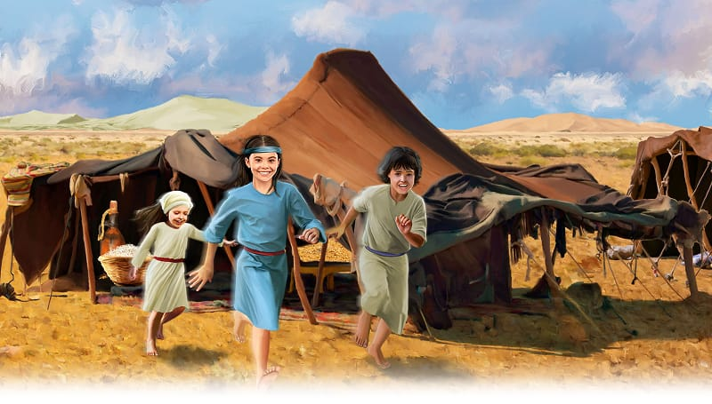
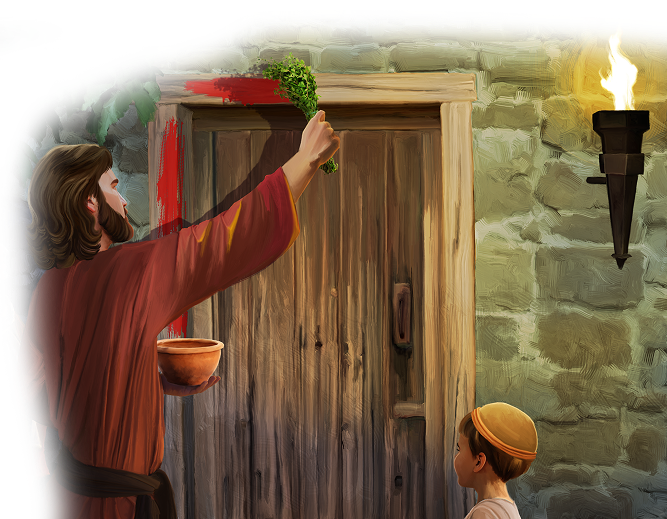

{"style":{"block":{"padding":{"start":"none","end":"none"},"rounded":false},"wrapper":{"padding":{"start":"none","end":"none"}},"image":{"aspectRatio":1.778}}}


The kids raced through the camp to find their friends. They jumped over baskets and darted around tent pegs. Others ran from their tents to join in. Soon it was a shouting, squealing game of chase.

The manna had been collected and eaten. The water had been fetched and the tent cleaned. All the morning jobs were done. They were free to play!

Just a few months before, back in Egypt, there was no playtime. All day long the kids had worked, worked, worked. They had been slaves, just like their parents. If they didn’t pick up enough straw or carry enough heavy stones, they were punished. The kids could remember the mean, powerful slave bosses and their whips. Ouch! It hadn’t been fun!

God had seen. He had told Moses, “I will punish Egypt with my power. And I will bring the Israelites out of that land. Then they will know I am the Lord” (Exodus 7:5, ICB).

God showed His power with 10 plagues. The kids remembered the stinky river, slimy frogs, and scary hail. God was more powerful than anyone! He was mighty to save.

On the Passover night the kids had helped their parents paint the doorposts with blood. They had eaten the special meal. Then they had waited for God’s angel to pass over their home, and save them.

{"style":{"block":{"padding":{"start":"none","end":"none"},"rounded":false},"wrapper":{"padding":{"start":"none","end":"none"}},"image":{"aspectRatio":1.778}}}


He did! They were safe, and before morning they were free. What a special day. What did God want all the Israelites to always do from that day onward? **Read Exodus 12:14.**

^[I Wonder]({"style": {"text": {"typeface": "DKWhaleSong-Regular", "color": "#8AC3A7", "size": "lg"}}})

- How many of the 10 plagues can you remember?
- Why do you think God always wanted them to remember that day?

^[Prayer Idea]({"style": {"text": {"typeface": "DKWhaleSong-Regular", "color": "#8AC3A7", "size": "lg"}}})\
Turn your memory verse into a prayer. “Dear Jesus, I will . . . [say your memory verse].”

^[Do]({"style": {"text": {"typeface": "DKWhaleSong-Regular", "color": "#8AC3A7", "size": "lg"}}})\
Make and add a picture to your remembering gallery of one of the plagues or Passover.

^[Do]({"style": {"text": {"typeface": "DKWhaleSong-Regular", "color": "#8AC3A7", "size": "lg"}}})\
Play in the outdoors, if possible. Collect 10 things that remind you that God is a powerful Creator.

```=Memory Verse

“Remember His marvelous works which He has done” (1 Chronicles 16:12).

```