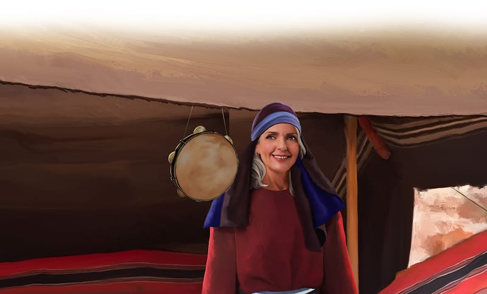
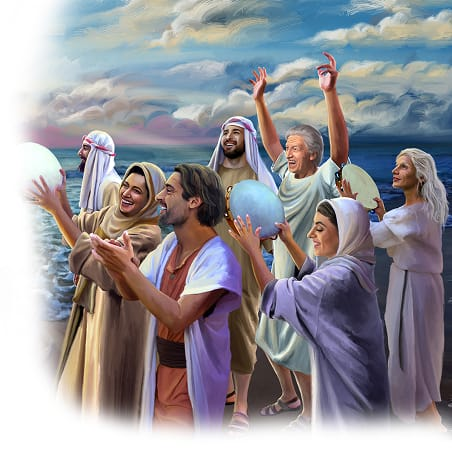

{"style":{"block":{"padding":{"start":"none","end":"none"},"rounded":false},"wrapper":{"padding":{"start":"none","end":"none"}},"image":{"aspectRatio":1.778}}}


Miriam heard the jingling of her tambourine as she brushed past it. She began to hum. There was a song that all of Israel had sung together. She could remember it well.

“I will sing to the Lord . . . . The horse and its rider He has thrown into the sea!” (Exodus 15:1).

It was such a powerful song. It told the story of God saving them. It would help them always remember God’s miracle.

What a miracle it was! God’s people had left Egypt and camped by the Red Sea. Then the angry Egyptian army had chased after them, with all their chariots. Oh, no! The Israelites were stuck! Would they need to fight? Can you remember what God told them? **Read Exodus 14:13, 14.**

God made a way! He opened up a dry path right through the middle of the Red Sea. There were tall walls of water on either side of the path while they walked through. Then crash! The water had covered their Egyptian enemies.

{"style":{"block":{"padding":{"start":"none","end":"none"},"rounded":false},"wrapper":{"padding":{"start":"none","end":"none"}},"image":{"aspectRatio":1.778}}}


God would keep being their protector. Right here at Mount Sinai He told them, “I am sending an angel ahead of you. He will protect you as you travel. . . . Pay attention to the angel and obey Him. . . . If you do this I will be an enemy to your enemies. I will fight all who fight against you” (Exodus 23:20-22, ICB).

They would just need to remember, trust, and obey.

^[I Wonder]({"style": {"text": {"typeface": "DKWhaleSong-Regular", "color": "#7994CC", "size": "lg"}}})

- Do you know any songs that are stories? Can you remember all the words to them?
- What does the Red Sea story help you remember about God?

^[Prayer Idea]({"style": {"text": {"typeface": "DKWhaleSong-Regular", "color": "#7994CC", "size": "lg"}}})\
Thank God for being our mighty helper and protector.

^[Do]({"style": {"text": {"typeface": "DKWhaleSong-Regular", "color": "#7994CC", "size": "lg"}}})\
Can you remember a praise song that fits with today’s story? Imagine singing it with Miriam. Perhaps “My God Is So Great. “

!a[my-god-is-so-great.mp3] “My God Is So Great” {"credits":[], "title": "Credits","copyright":"Public domain."}

^[Do]({"style": {"text": {"typeface": "DKWhaleSong-Regular", "color": "#7994CC", "size": "lg"}}})\
Make and add a picture from today’s story to your special remembering gallery.

```=Memory Verse

“Remember His marvelous works which He has done” (1 Chronicles 16:12).

```