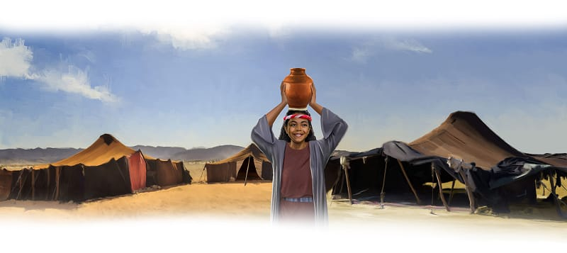

{"style":{"block":{"padding":{"start":"none","end":"none"},"rounded":false},"wrapper":{"padding":{"start":"none","end":"none"}},"image":{"aspectRatio":1.778}}}


_Wobble, wobble . . . splash_! Quickly the girl grabbed the water jar with two hands. She balanced it on her head, and tried again. Wobble, wobble . . . no splash. Oh, that’s better. Carefully she walked back into the camp.

She would take the water to her mother. It could be used to clean the whole family. A little splash could help make yummy manna cakes. Baby brother’s things could be washed. Then everyone could have a long drink as it was a very hot day.

All the people of Israel had water in this dry desert. When they’d found bitter water, God had made it sweet. When they’d found no water, what did God do? **Read Exodus 17:6.**

God had done the impossible for them! The Bible says, “Remember His marvelous works which He has done” (1 Chronicles 16:12).

{"style":{"block":{"padding":{"start":"none","end":"none"},"rounded":false},"wrapper":{"padding":{"start":"none","end":"none"}},"image":{"aspectRatio":1.778}}}


The Israelites could remember and be full of thanks. But sometimes they weren’t. Sometimes they forgot that God was their provider. They had grumbled and moaned, whined and whined.

But God still provided for them! Every morning, except for Sabbath, God sent bread from heaven. Psalm 78:25 calls it “angels’ food.” Manna was all they needed.

One day God told Moses to tell Aaron, “Take a jar and fill it with two quarts of manna. And save this manna for your descendants [future families]” (Exodus 16:33, ICB). Aaron put it with the Ten Commandments in the new sanctuary. They would keep it so they could remember God’s miracles forever.

^[I Wonder]({"style": {"text": {"typeface": "DKWhaleSong-Regular", "color": "#21A0A9", "size": "lg"}}})

- Can you remember how long manna normally lasted? Why do you think God made the manna that was in the ark with the Ten Commandments not be rotten but last for many years?
- What do the stories of the miracle water and food help you remember about God?

^[Prayer Idea]({"style": {"text": {"typeface": "DKWhaleSong-Regular", "color": "#21A0A9", "size": "lg"}}})\
Thank God that He is our provider.

^[Do]({"style": {"text": {"typeface": "DKWhaleSong-Regular", "color": "#21A0A9", "size": "lg"}}})\
With help, make fruit kebabs (slices of fruit on a skewer) or fruit parcels (wrap slices in decorated paper) and “provide” them to a neighbor. Tell them God loves them and so do you.

^[Do]({"style": {"text": {"typeface": "DKWhaleSong-Regular", "color": "#21A0A9", "size": "lg"}}})\
Make and add a picture from today’s story of the miracle water and food to your remembering gallery.

```=Memory Verse

“Remember His marvelous works which He has done” (1 Chronicles 16:12).

```