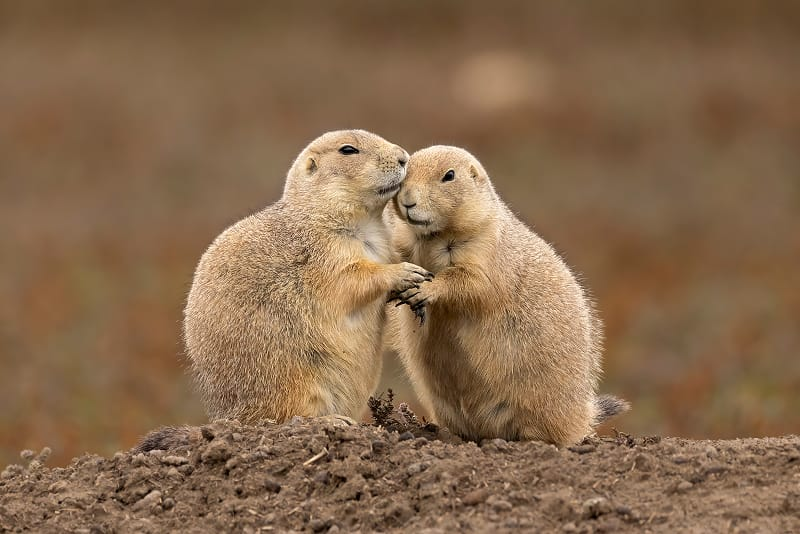

{"style": {"text": {"color": "#F4793B"}}}
**Big Idea:** God created prairie dogs to live together in close-knit families. We are designed to care for each other in similar ways.

- **Have you ever been underground?** Imagine what it would be like to live in tunnels and underground rooms with those in your family.

{"style":{"image":{"aspectRatio":1.778}}}

Let’s find out about prairie dogs, who live underground with their families.

Prairie dogs are cute little animals related to squirrels. They are found in wide-open grasslands of North America. In fact, if you found one, you would probably find many because they pop in and out of their underground towns, called colonies, that can sometimes house thousands of prairie dogs. The biggest prairie dog colony ever recorded was in Texas and covered 25,000 square miles (64,750 square kilometers)!

Within a colony, prairie dogs live in small, close-knit family groups called coteries. They have well-organized homes. Prairie dogs dig long and complex burrows that have separate areas for sleeping, raising their young, and going to the toilet. The burrows are even well designed to let fresh air flow through them.

Prairie dog families groom one another, share food, kiss and nuzzle one another to show affection, show their teeth to greet one another, and protect each other from enemy prairie dogs. At every entrance to the colony there is a listening post with a guard standing watch. When danger is near, the guard uses “prairie dog language” to warn one another. This is said to be even more complex than that of dolphins! Prairie dogs use short barks and chirps to share information about a predator. Information about a predator’s size, color, direction, and speed can be given in a single bark. They even have special calls that describe a human with a gun, whether he’s tall or short, and if he’s wearing the color blue. Now, that’s extra-special protection from a prairie dog who loves his family!

- **How are prairie dog families similar to yours?**