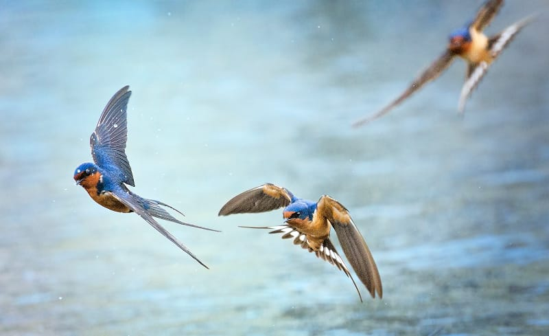

{"style": {"text": {"color": "#F4793B"}}}
**Focus:** Parent barn swallows work together to build the perfect nest-home for their young.

{"style":{"image":{"aspectRatio":1.778}}}

- **Have you ever seen a bird’s nest up close?**
- **What materials did the bird use to build it?**

If you live in the country in North America, keep an eye on mud puddles in early summer. You will likely see a pair of barn swallows making frequent trips between the mud puddle and high up on a barn or house wall, or the top of a beam inside a barn, or the underside of a bridge. These busy birds will be building a nest to lay eggs in, and then raise their hungry chicks when they have hatched.

The male and female barn swallows usually work on their nest in the morning. They collect mud in their bills, sometimes mixing it with grass stems to make little beads. First the busy birds make a little shelf to sit on; then they slowly build up the sides of the nest. It takes between 1,200 and 2,000 mud beads to build a nest. If the nest is built on a wall, it will be shaped like half of a cup. If the nest is built on top of a barn beam, it will be shaped like a cup, about three inches wide. The swallows will make about 1,000 trips to collect mud before the nest is completed. It is the perfect size for the mother bird to nestle in close to her eggs and chicks.

When the nest is completed, it is lined with grass and feathers to make a soft, warm home for the little family of three to eight chicks that will be raised there. God has put this building knowledge inside these clever creatures. He gives them the ability to work together happily as they build a perfect little bird home.

**Discuss:**

- **How do the barn swallows remind you of the Israelite builders?**
- **How does the mother swallow remind you of God?**

---

https://www.allaboutbirds.org/guide/Barn_Swallow/overview

https://www.wild-bird-watching.com/Barn-Swallow.html

https://www.nativeanimalrescue.org/the-amazing-swallow/