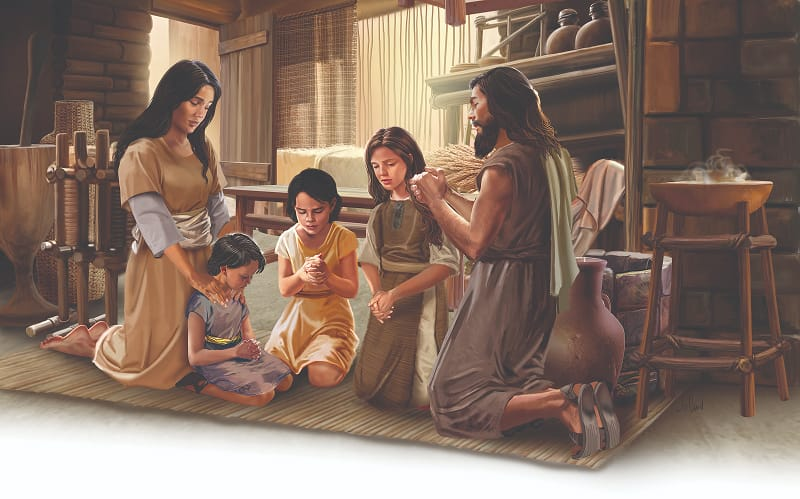

{"style":{"block":{"padding":{"start":"none","end":"none"},"rounded":false},"wrapper":{"padding":{"start":"none","end":"none"}},"image":{"aspectRatio":1.778}}}


Baby Moses was safely back with his very happy family in their little mud-brick home. Miriam and Aaron played outside with their little brother, and no one could snatch him away. Moses cried, and it didn’t matter who heard.

Mother Jochebed believed God had saved Moses for something great. She also knew he would go to live in the palace with the princess one day. So Jochebed needed to do all she could to teach Moses to love and respect the wonderful God who had saved him.

The Egyptians worshipped the sun as a god, but Jochebed taught Moses to worship the one true God, who had created the sun. The Egyptians believed that a goddess, Nut, controlled the stars, but Jochebed knew the true story of Creation. She taught Moses to pray to God, who had formed the heavens and the earth. She told him wonderful stories about Adam and Eve, Noah, and Abraham. She taught him how to pray and how to be kind, friendly, and thoughtful. No doubt she gently taught him to be helpful, polite, and obedient too. But most of all she taught Moses about God’s love in ways that made him want to love God back. To be His friend. To trust Him. To follow Him. To be faithful and do what He asked. What Bible advice was Mother Jochebed following? **Read Deuteronomy 11:18, 19.**

Through all those days of childhood teaching, Mother Jochebed prayed for her precious son. She knew that in the palace Moses would be surrounded by idol worshippers, who didn’t know or love God. It was important that he be prepared for that time. He would need to know God as his very best friend in the royal courts; a friend who would always hear and help him.

God has put loving parents, or other caring adults, in your life to pray for you, care for you, and teach you about God’s love. Just like Mother Jochebed, they want to help you grow up to know and love Jesus so you can do a special work for Him.

{"style": {"text": {"typeface": "Trashbone-Regular", "color": "#894545", "size": "xl"}}}
THINK . . . THEN TALK ABOUT IT:

- What do you think Miriam and Aaron might have done to help Moses love God?
- Who prays for you? Why not thank them?

{"style": {"block": {"backgroundColor": "#FFF1FA", "padding": {"top": "sm", "start": "base", "end":"sm", "bottom": "sm"}}, "text": {"color": "#885D7A"}}}
^[FOR YOU, PARENTS:]({"style": {"text": {"typeface": "Trashbone-Regular", "size": "xl"}}}) “The deep engraving of truth in the heart is never wholly effaced. It may be obscured, but can never be obliterated. The impressions made in early life will be seen in after years” (Ellen G. White, _Testimonies_, vol. 6, p. 359).

{"style": {"block": {"backgroundColor": "#f1f6ee", "padding": {"top": "sm", "start": "base", "end":"sm", "bottom": "sm"}}, "text": {"color": "#78a057"}}}
^[PRAY:]({"style": {"text": {"typeface": "Trashbone-Regular", "size": "xl"}}}) Praise God for adults who pray for you.

```=Memory Verse

“For we are His workmanship, created in Christ Jesus for good works” (Ephesians 2:10).

```