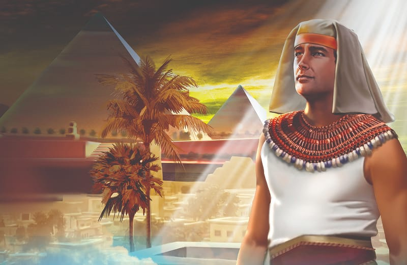
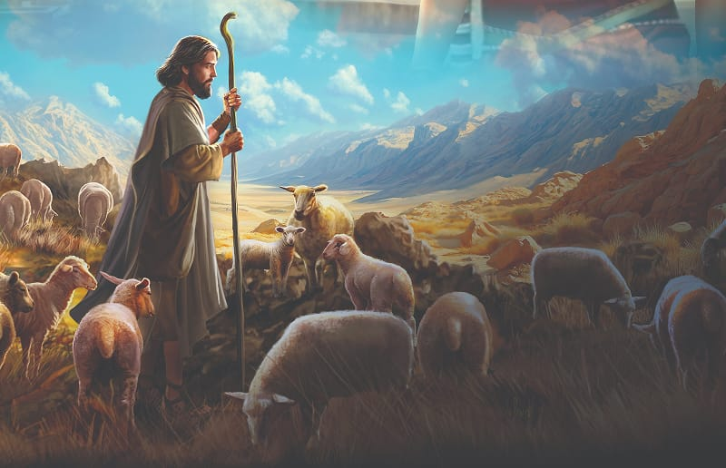
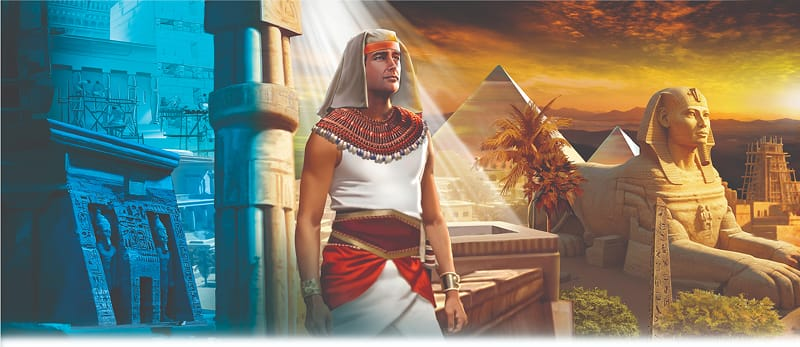

{"style":{"block":{"padding":{"start":"none","end":"none"},"rounded":false},"wrapper":{"padding":{"start":"none","end":"none"}},"image":{"aspectRatio":1.778}}}


{"style": {"block": {"backgroundColor": "#b95c2b", "padding": {"top": "sm", "start": "base", "end":"sm", "bottom": "sm"}}, "text": {"typeface": "GoodlifeW00-SansCondensed", "color": "#FFFFFF"}}}
When God asks me to do something for Him, He will help me to do it.

{"style": {"text": {"typeface": "ITCAvantGardeStd-BoldCn", "size": "lg"}}}
**^[MEMORY VERSE]({"style": {"text": {"size": "sm"}}})**\
**“Behold, God is my salvation, I will trust and not be afraid; ‘for Yah, the Lord, is my strength and song; He also has become my salvation’ ” (Isaiah 12:2).**

^[Word of the Week—Submit:]({"style": {"text": {"typeface": "Trashbone-Regular", "color": "#b95c2b", "size": "xl"}}})\
To humbly and willingly be under the control and power of another.

{"style": {"text": {"color": "#3d8b5a", "size": "sm"}}}
This week’s lesson is based on Exodus 2:11-23; 3; and 4:1-17; _Patriarchs and Prophets_, pp. 246-256; _The Seventh-day Adventist Bible Commentary_, vol.1, p. 1099; _Fundamentals of Christian Education_, pp. 342, 343; _The Ministry of Healing_, pp. 474, 475; and _Education_, pp. 62-64. **Extra Reading:** _The Bible Story_, vol. 2, pp. 89-100.

{"style":{"block":{"padding":{"start":"none","end":"none"},"rounded":false},"wrapper":{"padding":{"start":"none","end":"none"}},"image":{"aspectRatio":1.778}}}


{"style": {"text": {"typeface": "Trashbone-Regular", "color": "#b95c2b", "size": "xl"}}}
In Need of Rescue

Moses smiled as he left the gleaming palace behind him and traveled through the bustling city. The Israelite baby that had been saved in the basket boat had grown up to be a mighty prince of Egypt. “And Moses was learned in all the wisdom of the Egyptians, and was mighty in words and deeds” (Acts 7:22).

As Moses looked out across the land, his smile faded. He saw Pharaoh’s fancy new cities, storehouses, and luxurious palaces. He saw the rich Egyptian clothing and the latest entertainment. And he also saw the poor people—his people—who had been forced to make the bricks to build whatever Pharaoh wanted.

{"style":{"block":{"padding":{"start":"none","end":"none"},"rounded":false},"wrapper":{"padding":{"start":"none","end":"none"}},"image":{"aspectRatio":1.778}}}


To make the mud bricks, the Israelites first had to gather mud from along the Nile River. This soil was a mix of clay and sand. If there was lots of clay in the mud, they could form it into a brick that would dry and become firm. But if the muddy slosh was too sandy, they would need to add straw. The Bible tells us the Israelites had to gather straw, as well as make endless bricks. The Egyptians “made their lives bitter with hard bondage—in mortar, in brick, and in all manner of service in the field” (Exodus 1:14).

Moses, a wise and mighty leader, saw how his people were overworked, hurt, and miserable. He saw their need for a rescuer. Would he be able to free his people—or would this be a job for God?

Jesus is our great rescuer. Even though He might not deliver us immediately from all our difficulties, He came to rescue us from sin, which has trapped us like slaves. The Bible says, “Jesus became like men and died so he could free them” (Hebrews 2:15, ICB). We can be forgiven and free right now, because of Jesus. One day soon Jesus will come to earth and take us to heaven, where we will be free from sin, and death, forever. **Read Jesus’ promise to you in John 14:3.** What a day that will be!

{"style": {"text": {"typeface": "Trashbone-Regular", "color": "#b95c2b", "size": "xl"}}}
THINK . . . THEN TALK ABOUT IT:

- **Read Isaiah 12:2**, your memory verse. Who in today’s story would have been comforted by this verse?

{"style": {"block": {"backgroundColor": "#eef0f1", "padding": {"top": "sm", "start": "base", "end":"sm", "bottom": "sm"}}, "text": {"color": "#56666f"}}}
^[DO:]({"style": {"text": {"typeface": "Trashbone-Regular", "size": "xl"}}}) Fill an old rectangular container with mud. If you have straw/hay, mix it through. Leave it in the sun to bake. Would this be a good brick? Alternatively, with a parent, find and watch a video clip of bricks being made by hand.

{"style": {"block": {"backgroundColor": "#f1f6ee", "padding": {"top": "sm", "start": "base", "end":"sm", "bottom": "sm"}}, "text": {"color": "#78a057"}}}
^[PRAY:]({"style": {"text": {"typeface": "Trashbone-Regular", "size": "xl"}}}) Thank Jesus for being our rescuer, and for the promise of His soon return.

```=Memory Verse

“Behold, God is my salvation, I will trust and not be afraid; ‘for YAH, the Lord is my strength and song; He also has become my salvation’ ” (Isaiah 12:2).

```