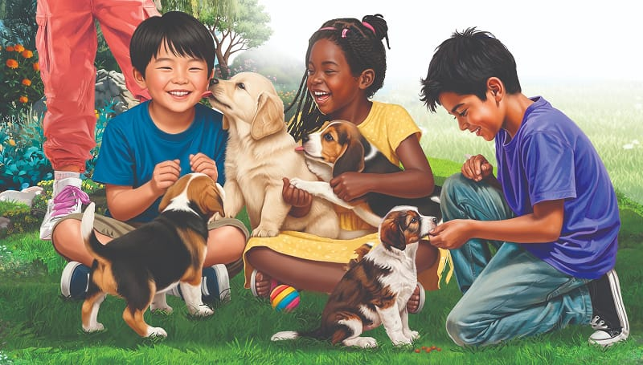

{"style":{"block":{"padding":{"start":"none","end":"none"},"rounded":false},"wrapper":{"padding":{"start":"none","end":"none"}},"image":{"aspectRatio":1.778}}}

There is a popular saying, “A dog is a man’s best friend.” This is often because dogs are very loyal. But it is also because they are submissive when they love their owners. They know who’s boss.

There are a number of ways a dog shows that it is submissive:

- When it rolls over and exposes its belly. This shows how safe the dog feels with the people around it. It cannot fight or protect itself while lying on its back; it usually wants a belly rub.
- When a dog gives you a big, toothy grin, it is submissively showing that it is not a threat.
- When a dog feels safe, it may sit down, lick its lips, and look away.
- When a dog holds its tail down low, it is usually submissive.
- A submissive dog will say hello to a more dominant dog by lowering its head and licking the other dog’s muzzle while not looking directly into its eyes.
- If a dog falls asleep in your presence, you know it is relaxed and submissive.

{"style":{"block":{"padding":{"start":"none","end":"none"},"rounded":false},"wrapper":{"padding":{"start":"none","end":"none"}},"image":{"aspectRatio":1.778}}}

---

{"style": {"text": {"size": "sm"}}}
http://www.vetstreet.com/our-pet-experts/7-signs-of-submissive-behavior-in-dogs.