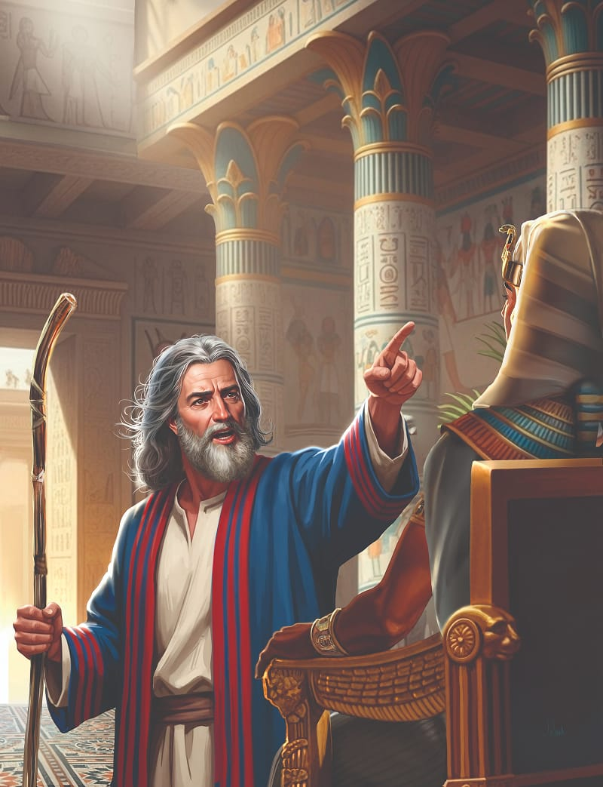
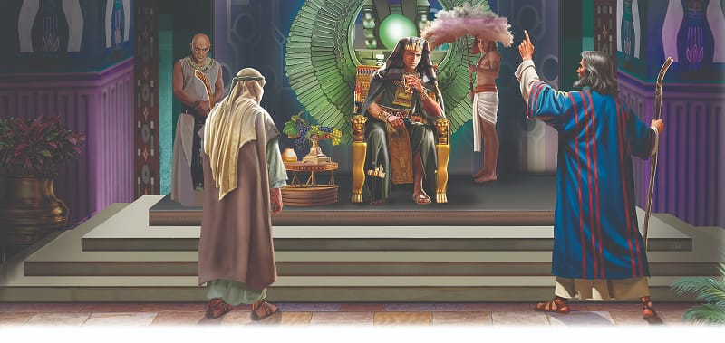

{"style":{"block":{"padding":{"start":"none","end":"none"},"rounded":false},"wrapper":{"padding":{"start":"none","end":"none"}},"image":{"aspectRatio":1.778}}}


{"style": {"block": {"backgroundColor": "#b95c2b", "padding": {"top": "sm", "start": "base", "end":"sm", "bottom": "sm"}}, "text": {"typeface": "GoodlifeW00-SansCondensed", "color": "#FFFFFF"}}}
God is the one true powerful God.

{"style": {"text": {"typeface": "ITCAvantGardeStd-BoldCn", "size": "lg"}}}
**^[MEMORY VERSE]({"style": {"text": {"size": "sm"}}})**\
**“Great is our Lord and mighty in power; His understanding is infinite” (Psalm 147:5).**

^[Word of the Week—Powerful:]({"style": {"text": {"typeface": "Trashbone-Regular", "color": "#b95c2b", "size": "xl"}}})\
Having great power or strength. How do you know someone or something is powerful? Look for ways that power is displayed in this week’s lesson.

{"style": {"text": {"color": "#3d8b5a", "size": "sm"}}}
This week’s lesson is based on Exodus 4:18-31; Psalm 105:28-36; _Patriarchs and Prophets_, pp. 257-280; and _The Seventh-day Adventist Bible Commentary_, vol. 1, pp. 515-545. **Extra Reading:** _The Bible Story_, vol. 2, pp. 101-114.

{"style":{"block":{"padding":{"start":"none","end":"none"},"rounded":false},"wrapper":{"padding":{"start":"none","end":"none"}},"image":{"aspectRatio":1.778}}}


{"style": {"text": {"typeface": "Trashbone-Regular", "color": "#693c87", "size": "xl"}}}
Meetings and Miracles

Moses and Aaron likely talked and talked as they walked and walked through the barren wilderness toward Egypt. Perhaps Moses sighed and shook his head sadly as Aaron described how harsh and painful it was to be a slave in Egypt. And perhaps Aaron smiled with wonder as Moses described his peaceful shepherd’s life in Midian and how God had spoken out loud from the burning bush. God had called both brothers to work together to free God’s people from slavery.

When the brothers eventually saw the pyramids of Egypt, they headed straight to God’s people in Goshen. They shared their message of hope: God had sent Moses to lead them out of Egypt. The elders listened and believed. The people listened and believed. It was so wonderful to know they would soon be free! They bowed their heads and worshipped God (Exodus 4:31).

Then Moses and Aaron strode over to the palace and boldly shared God’s message with Pharaoh: “Let my people go, that they may hold a feast to Me in the wilderness” (Exodus 5:1). Such talk made Pharaoh really mad. How dare the Hebrews ask for a holiday to worship their God! What did he say to Moses and Aaron? **Read Exodus 5:2.**

The brothers listened, and bravely made their request again. “The God of the Hebrews has met with us. Please, let us go three days’ journey into the desert and sacrifice to the Lord our God” (Exodus 5:3).

Pharaoh’s eyes blazed with anger as he stubbornly refused to let the Hebrews go. He had no respect for the God of heaven.

Our loving God will be close to us and give us the courage to speak bravely for Him too. Sometimes people won’t listen, but when we speak up, and do it wisely and with tact, we are giving them the opportunity to know the only powerful and true God.

{"style": {"text": {"typeface": "Trashbone-Regular", "color": "#693c87", "size": "xl"}}}
THINK . . . THEN TALK ABOUT IT:

- How brave would you have been if you had to talk to Pharaoh?
- Why were Moses and Aaron so brave?

{"style": {"block": {"backgroundColor": "#f1f6ee", "padding": {"top": "sm", "start": "base", "end":"sm", "bottom": "sm"}}, "text": {"color": "#78a057"}}}
^[PRAY:]({"style": {"text": {"typeface": "Trashbone-Regular", "size": "xl"}}}) Interlock your fingers and think about how closely the lives of Moses and Aaron were intertwined with God’s when they talked to Pharaoh. Ask God to be close to you, too, so that you can speak up bravely for Him.

{"style": {"block": {"backgroundColor": "#f3eff2", "padding": {"top": "sm", "start": "base", "end":"sm", "bottom": "sm"}}, "text": {"color": "#885d79"}}}
^[PARENT FAITH TALK:]({"style": {"text": {"typeface": "Trashbone-Regular", "size": "xl"}}}) Share a time you have witnessed bravely for God.

```=Memory Verse

“Great is our Lord and mighty in power; His understanding is infinite” (Psalm 147:5).

```