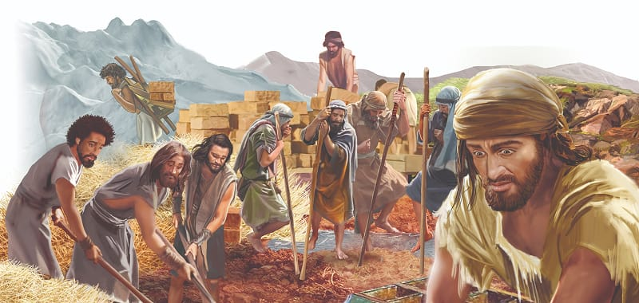

{"style":{"block":{"padding":{"start":"none","end":"none"},"rounded":false},"wrapper":{"padding":{"start":"none","end":"none"}},"image":{"aspectRatio":1.778}}}


Pharaoh was fuming! His face red, his fists clenched, he stormed through the palace. How dare these Hebrews tell me what to do, he thought. I’ll show them and their God who rules Egypt!

Angrily he marched over to the taskmasters and said, “You shall no longer give the people straw to make bricks as before. Let them go and gather straw for themselves” (Exodus 5:7). The slaves would have to work harder—much harder—because they were still expected to make the same number of bricks.

The slaves tried their very hardest, but of course they couldn’t do it. The harsh words of the taskmasters rang in their ears, and the cruel whips stung their backs. Never had they been in greater trouble.

Tired and hurting, the slaves soon became angry and blamed Moses and Aaron for the terrible new rule. They cried out, “May the Lord punish you. You caused the king and His officers to hate us. You have given them an excuse to kill us” (Exodus 5:21, ICB). Of course, that wasn’t true!

Moses knelt sadly before His God. What did Moses pray? **Read Exodus 5:22, 23.** Moses knew he could go to God and ask the questions on his mind. He was honest with God, for he knew God would answer. And God did. He kindly told Moses that He would soon force Pharaoh to let the people go. In fact, in the end Pharaoh would beg them to leave!

God also reminded Moses, “I am the Lord” (Exodus 6:2).

Even though it looked as if God had forgotten His people, He was still very close to them. Pharaoh didn’t believe, the Israelites were too discouraged to believe, but God was still in control. Things would get better soon, for God had promised.

{"style": {"text": {"typeface": "Trashbone-Regular", "color": "#b95c2b", "size": "xl"}}}
THINK . . . THEN TALK ABOUT IT:

- **Read Psalm 55:22.** Whom could this promise have encouraged in today’s story?
- What do you think will happen next in Egypt?
- Things won’t always go well for us when we do God’s work, but we can always talk to God honestly. He will always listen. We can also remember that God is with us, and that things will get better in the end.

{"style": {"block": {"backgroundColor": "#eef0f1", "padding": {"top": "sm", "start": "base", "end":"sm", "bottom": "sm"}}, "text": {"color": "#56666f"}}}
^[DO:]({"style": {"text": {"typeface": "Trashbone-Regular", "size": "xl"}}}) Share Psalm 55:22 with someone to encourage them. You may like to read it to them or write it on a card.

{"style": {"block": {"backgroundColor": "#f8f1ec", "padding": {"top": "sm", "start": "base", "end":"sm", "bottom": "sm"}}, "text": {"color": "#dd8f53"}}}
^[MISSION CHALLENGE:]({"style": {"text": {"typeface": "Trashbone-Regular"}}}) Pray each day for God to show you how you might do something special for Him. Pay attention to the people He brings to you, and look out for ways they may need help.

{"style": {"block": {"backgroundColor": "#f1f6ee", "padding": {"top": "sm", "start": "base", "end":"sm", "bottom": "sm"}}, "text": {"color": "#78a057"}}}
^[PRAY:]({"style": {"text": {"typeface": "Trashbone-Regular", "size": "xl"}}}) Thank God for being with you, even when it seems He isn’t.

```=Memory Verse

“Great is our Lord and mighty in power; His understanding is infinite” (Psalm 147:5).

```