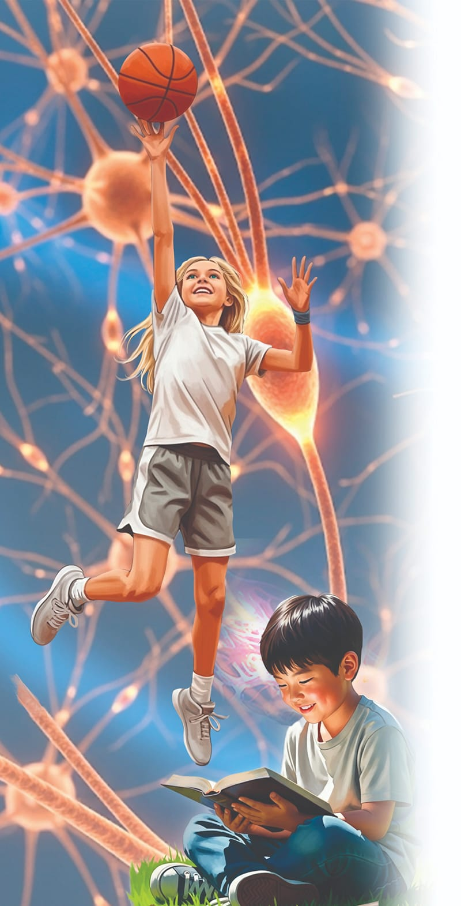

{"style":{"block":{"padding":{"start":"none","end":"none"},"rounded":false},"wrapper":{"padding":{"start":"none","end":"none"}},"image":{"aspectRatio":1.778}}}

God says in Psalm 139:14 that you are “fearfully and wonderfully made.” Everything about the way your body works is wonderful. But the most amazing part of your body is your brain, for it controls everything else your body does.

Your amazing brain has two types of cells; neurons and glia. Both are extremely tiny, and your brain contains billions of them. In fact, you have about 86 billion neurons! All of those neurons are extremely busy.

Neurons are information gatherers and messengers that talk to each other along neural pathways. When you choose to think about or learn something new, particular neurons start building a neural pathway so they can pass information to each other. At first the neural pathway is like a very, very thin thread. But as the information passes between the neurons again and again, the neural pathway becomes thicker and stronger, like a sturdy rope.

The more you accept and practice a new skill or way of thinking, the stronger your neural pathways become. It becomes faster and easier for you to follow the same thinking pattern or perform the same task or skill. This is how you form new habits, such as making your bed or spending time with Jesus.

{"style":{"block":{"padding":{"start":"none","end":"none"},"rounded":false},"wrapper":{"padding":{"start":"none","end":"none"}},"image":{"aspectRatio":1.778}}}

Sometimes you have to really challenge your brain to think in a new way. You have to work hard to stimulate growth and create new neural pathways. And sometimes you even have to work hard so that neural pathways that carry not-so-good information will die off!

Pharaoh had some strong, not-so-good neural pathways because he had chosen to keep those thought patterns for a long time. When God sent the plagues, He was wanting to help Pharaoh’s neural pathways to weaken as better ones were formed and strengthened. But Pharaoh didn’t choose God, so the old neural pathways just got stronger. On the other hand, the Israelites were open to the new way of thinking and acting that God was leading them to. They were beginning to form wonderful new neural pathways, pathways that would help them to love and trust God.