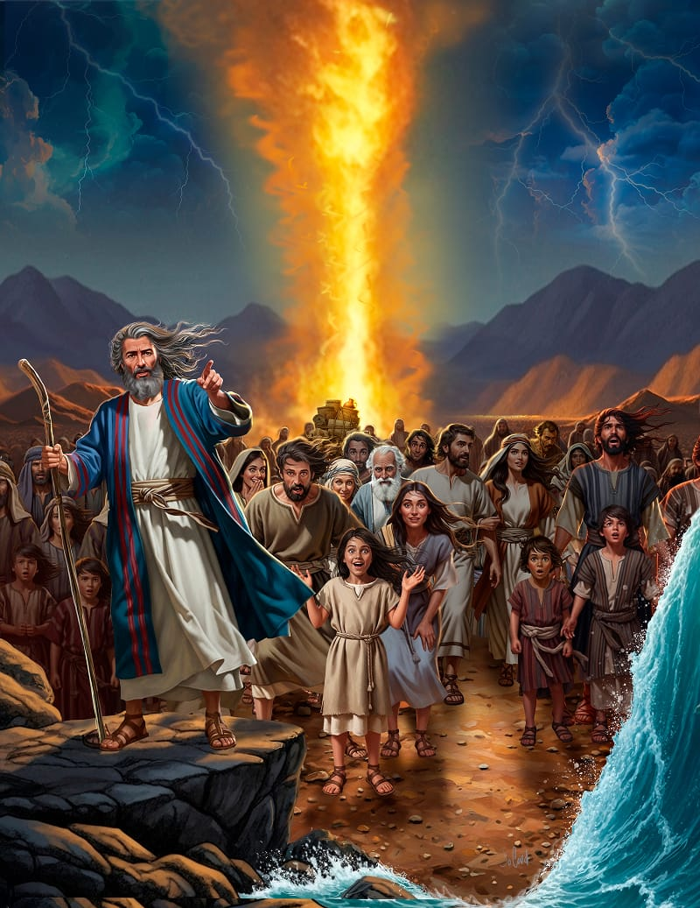
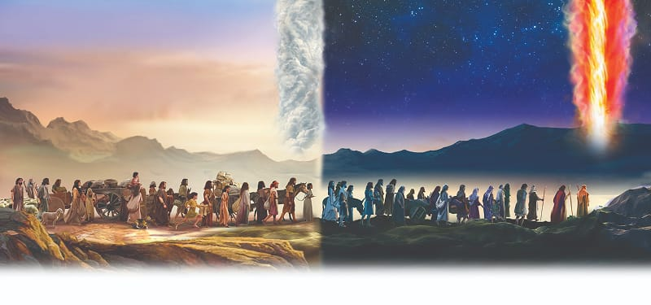

{"style":{"block":{"padding":{"start":"none","end":"none"},"rounded":false},"wrapper":{"padding":{"start":"none","end":"none"}},"image":{"aspectRatio":1.778}}}


{"style": {"block": {"backgroundColor": "#4693a7", "padding": {"top": "sm", "start": "base", "end":"sm", "bottom": "sm"}}, "text": {"typeface": "GoodlifeW00-SansCondensed", "color": "#FFFFFF"}}}
God is the most trustworthy leader of all.

{"style": {"text": {"typeface": "ITCAvantGardeStd-BoldCn", "size": "lg"}}}
**^[MEMORY VERSE]({"style": {"text": {"size": "sm"}}})**\
**“ ‘Do not be afraid. Stand still, and see the salvation of the Lord, which He will accomplish for you today’ ” (Exodus 14:13).**

^[Word of the Week—Leader:]({"style": {"text": {"typeface": "Trashbone-Regular", "color": "#4693a7", "size": "xl"}}})\
Someone who guides other people, inspiring those people to follow them or to meet a goal.

{"style": {"text": {"color": "#3d8b5a", "size": "sm"}}}
This week’s lesson is based on Exodus 13:17 to 15:21; _Patriarchs and Prophets_, pp. 282-290; Testimonies for the Church, vol. 1, p. 265; Testimonies for the Church, vol. 4, pp. 20-28; and _The Seventh-day Adventist Bible Commentary_, vol. 1, pp. 568-573. **Extra Reading:** _The Bible Story_, vol. 2, pp. 123-138.

{"style":{"block":{"padding":{"start":"none","end":"none"},"rounded":false},"wrapper":{"padding":{"start":"none","end":"none"}},"image":{"aspectRatio":1.778}}}


{"style": {"text": {"typeface": "Trashbone-Regular", "color": "#693c87", "size": "xl"}}}
Under God’s Protection

Faint rays of sunlight streaked the early-morning sky. As the waking Israelites rose stiffly from the ground and rubbed their eyes, they remembered the incredible events of the past few days. They were no longer slaves—they were free! They were finally on their way to the Promised Land!

But they were still only one day’s journey away from Pharaoh and their former home in Egypt, and that was not far enough. Pharaoh might just change his mind again and come chasing after them. They must be on the move, and quickly!

The farther they went from Egypt, the hotter and drier the wilderness became. Before long the searing sun was unbearably hot. Then in the evening the warmth of the day quickly changed to the coldness and blackness of a desert night. Trudging in the daytime heat and sleeping in the chilly night air was no fun at all.

God knew how much His people needed protection and encouragement in the wilderness, so He did something wonderful. What did He do? **Read Exodus 13:21.**

At night the Israelites rested comfortably under the pillar of fire God had spread above them. During the day God’s special cloud gave moisture and protection from the burning desert heat. And best of all, God was in the cloud. No matter where they were, they could always see God’s protective presence and know that He was with them.

Our loving God protects us and provides for our needs in many ways. He provides the food, shelter, and love we need. We can thank Him for His promise in Philippians 4:19: “And my God shall supply all your need according to His riches in glory by Christ Jesus.”

{"style": {"text": {"typeface": "Trashbone-Regular", "color": "#693c87", "size": "xl"}}}
THINK . . . THEN TALK ABOUT IT:

- What did the cloud tell the Israelites about God? How did it build their faith?
- How would you have felt going to sleep under God’s pillar of fire and traveling under His cool cloud?

{"style": {"block": {"backgroundColor": "#f1f6ee", "padding": {"top": "sm", "start": "base", "end":"sm", "bottom": "sm"}}, "text": {"color": "#78a057"}}}
^[PRAY:]({"style": {"text": {"typeface": "Trashbone-Regular", "size": "xl"}}}) **Read King David’s prayer in Psalm 42:8.** Thank God for showing you His love during the day and for protecting your sleep at night.

{"style": {"block": {"backgroundColor": "#f8f1ec", "padding": {"top": "sm", "start": "base", "end":"sm", "bottom": "sm"}}, "text": {"color": "#dd8f53"}}}
^[MISSION CHALLENGE:]({"style": {"text": {"typeface": "Trashbone-Regular"}}}) Look for an older person in your neighborhood who may not know the truth about God’s love. Pray, then gently share with them what you’re learning about God.

{"style": {"block": {"backgroundColor": "#eef0f1", "padding": {"top": "sm", "start": "base", "end":"sm", "bottom": "sm"}}, "text": {"color": "#56666f"}}}
^[DO:]({"style": {"text": {"typeface": "Trashbone-Regular", "size": "xl"}}}) Light a candle. How much light does it give? What would it be like to see an enormous cloud of fire?

```=Memory Verse

“ ‘Do not be afraid. Stand still, and see the salvation of the Lord, which He will accomplish for you today.’ ” (Exodus 14:13).

```