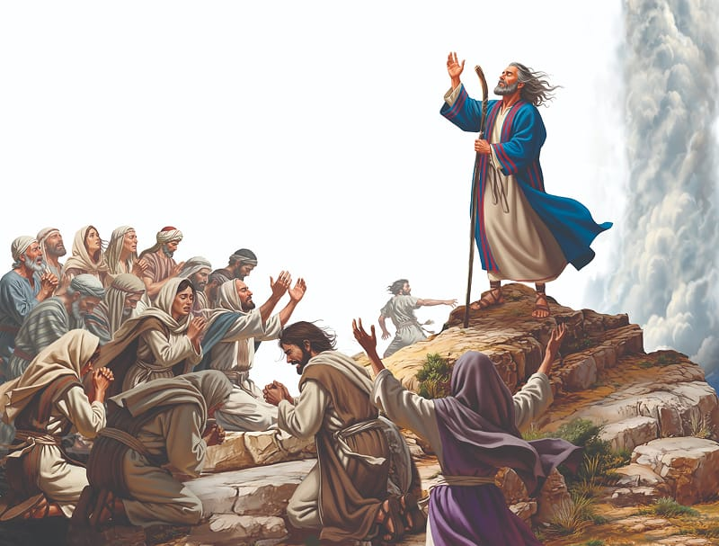

{"style":{"block":{"padding":{"start":"none","end":"none"},"rounded":false},"wrapper":{"padding":{"start":"none","end":"none"}},"image":{"aspectRatio":1.778}}}


March, march, march . . . God’s people followed the cloud all day through the barren desert. They were still headed south toward the Red Sea, where they would camp between rugged mountain ranges for the night.

Meanwhile, back in Egypt, Pharaoh was fuming! He was downright mad that his slaves weren’t there to build, and plant, and clean up the mess the plagues had left. He wanted them back—now!

The Bible tells us, “So he made ready his chariot and took his people with him. Also, he took six hundred choice chariots, and all the chariots of Egypt with captains over every one of them” (Exodus 14:6, 7).

Proud and determined, Pharaoh drove his own chariot at the head of the Egyptian army. In a great cloud of dust they sped over the desert toward the Israelites.

When the Israelites looked up and saw the Egyptians advancing, they were filled with terror. The Red Sea was before them, with a wall of mountains on either side. There was no escape—they were trapped! The faithful Israelites cried out to the Lord, but most of the people wailed and screamed aloud. What did they say to Moses? **Read Exodus 14:11, 12.**

God, their trustworthy leader, was still right there in the cloud. But the people were so fearful they forgot about their faith in God.

We can always trust God as our powerful leader, even when we can’t see a way out of a difficult situation. His Word reminds us, “The Lord will guide you continually” (Isaiah 58:11).

{"style": {"text": {"typeface": "Trashbone-Regular", "color": "#78a057", "size": "xl"}}}
THINK . . . THEN TALK ABOUT IT:

- What are you afraid of?
- Which Bible promise will you remember to say and believe next time you are afraid?

{"style": {"block": {"backgroundColor": "#f1f6ee", "padding": {"top": "sm", "start": "base", "end":"sm", "bottom": "sm"}}, "text": {"color": "#78a057"}}}
^[PRAY:]({"style": {"text": {"typeface": "Trashbone-Regular", "size": "xl"}}}) Write a short prayer of faith in your Bible Promise Journal.

{"style": {"block": {"backgroundColor": "#eef0f1", "padding": {"top": "sm", "start": "base", "end":"sm", "bottom": "sm"}}, "text": {"color": "#56666f"}}}
^[DO:]({"style": {"text": {"typeface": "Trashbone-Regular", "size": "xl"}}}) Make and decorate a card to give to a friend or family member, to encourage them. Include the full verse in Isaiah 58:11.

```=Memory Verse

“ ‘Do not be afraid. Stand still, and see the salvation of the Lord, which He will accomplish for you today.’ ” (Exodus 14:13).

```